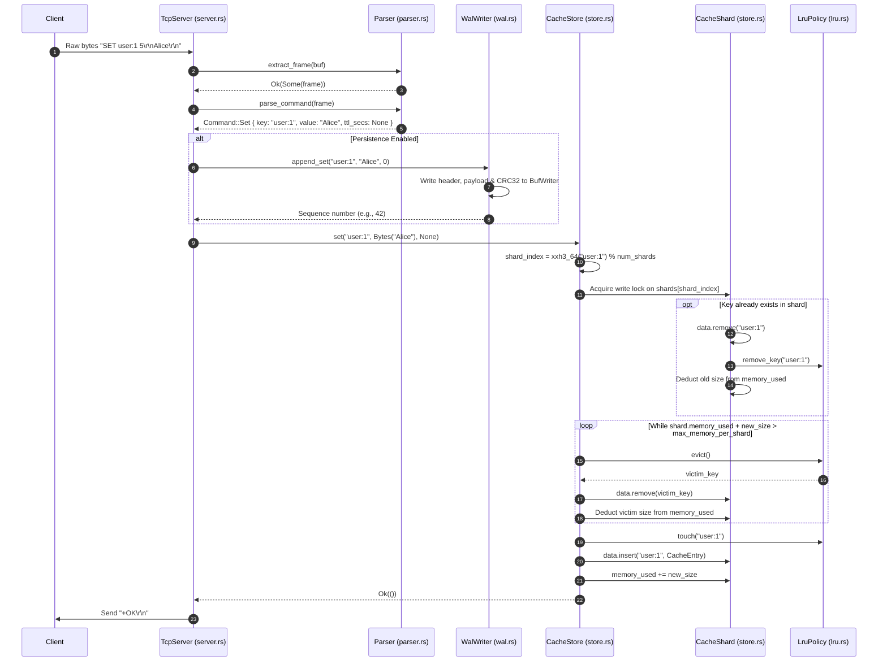
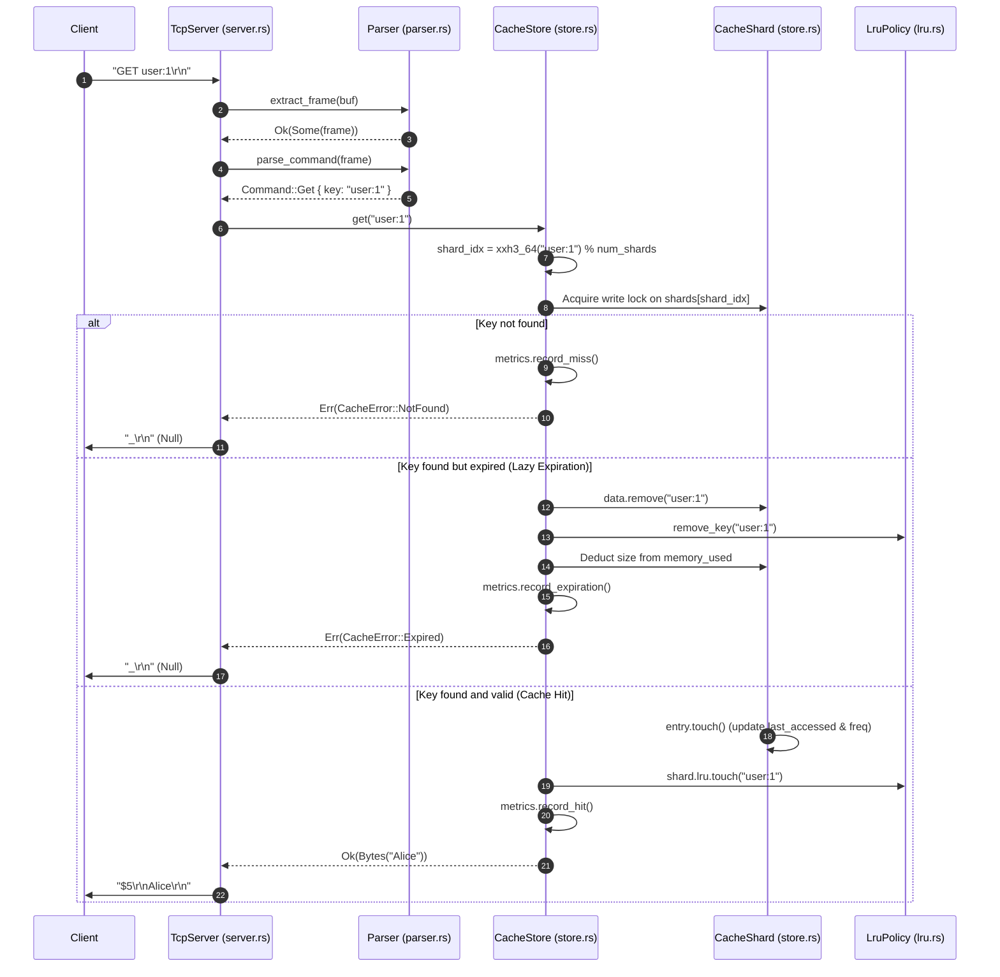
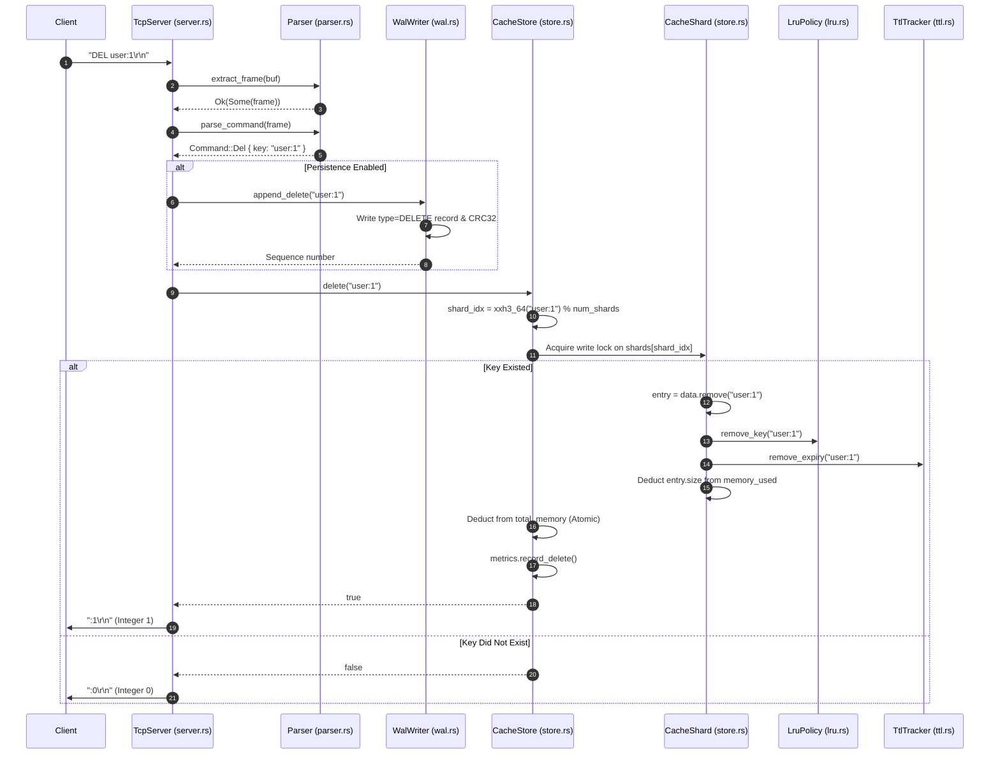

# 01 — Project Overview & System Understanding

This document establishes the foundational understanding of the **FluxCache** workspace: its structure, package boundaries, configuration surface, entry points, problem domain, and the step-by-step code execution flow of primary cache operations (`SET`, `GET`, `DEL`).

---

## 1. Workspace Structure & Cargo Packages

FluxCache is organized as a Cargo multi-package workspace defined in the root `Cargo.toml`:

```toml
[workspace]
members = [
    "fluxcache",
    "fluxcache-client",
    "fluxcache-bench"
]
```

### 1.1 Packages Summary

| Package | Path | Type | Role & Responsibility |
|---|---|---|---|
| **`fluxcache`** | `fluxcache/` | Binary (`fluxcache`) & Library (`libfluxcache`) | The core in-memory caching engine, network server, persistence engine (WAL/snapshots), replication daemon, and HTTP administrative plane. |
| **`fluxcache-client`** | `fluxcache-client/` | Library (`fluxcache-client`) | High-level asynchronous client SDK for Rust applications. Provides single-node connection management, deadpool connection pooling, and multi-node client-side consistent hashing. |
| **`fluxcache-bench`** | `fluxcache-bench/` | Binary (`fluxcache-bench`) | Standalone multi-threaded load testing and benchmarking tool. Measures throughput and latency percentiles (min, p50, p95, p99, max) using `hdrhistogram`. |

---

## 2. Important Modules & Responsibilities (`fluxcache`)

The core server `fluxcache` exports all subsystems through `fluxcache/src/lib.rs`:

```rust
// fluxcache/src/lib.rs
pub mod cache;
pub mod config;
pub mod metrics;
pub mod persistence;
pub mod protocol;
pub mod replication;
pub mod server;
pub mod shard;
pub mod shutdown;
pub mod singleflight;
```

### Module Breakdown

1. **`cache` (`fluxcache/src/cache/`)**:
   - `entry.rs`: Defines `CacheEntry` (value `Bytes`, creation/access timestamps, frequency, optional expiration, memory size calculation).
   - `lru.rs`: Implements an $O(1)$ LRU eviction tracker using an arena-allocated doubly-linked list (`Vec<LruNode>`) with an index-based free list (`free_list: Vec<usize>`) and `HashMap<String, usize>`.
   - `lfu.rs`: Implements an LFU eviction tracker with frequency bucketing (`BTreeMap<u64, HashSet<String>>`) and decay/aging mechanism to halve frequencies periodically.
   - `ttl.rs`: Implements `TtlTracker` using a time-ordered `BTreeMap<Instant, Vec<String>>` and a reverse index `HashMap<String, Instant>` for active and lazy TTL expiration.
   - `store.rs`: The central sharded data store (`CacheStore`). Partitions data into $N$ `CacheShard` instances, each guarded by an independent `tokio::sync::RwLock`. Manages shard-level memory limits and eviction triggers.

2. **`protocol` (`fluxcache/src/protocol/`)**:
   - `command.rs`: Defines the `Command` enum (`Ping`, `Get`, `Set`, `Del`, `Exists`, `Expire`, `Ttl`, `Stats`).
   - `parser.rs`: Custom zero-copy-oriented parser. Supports length-prefixed binary framing (`[4-byte BE length][payload]`) and interactive CRLF-delimited ASCII lines with inline length-prefixed binary payloads for `SET`.
   - `response.rs`: Serialization of server responses into Redis-compatible RESP-style wire frames (`+OK`, `$len\r\ndata\r\n`, `:int`, `_\r\n`, `-ERR`).

3. **`persistence` (`fluxcache/src/persistence/`)**:
   - `wal.rs`: Write-Ahead Log writer (`WalWriter`) and reader (`WalReader`). Appends mutation records with a 30-byte fixed header, length-prefixed payload, and CRC32 checksum. Provides crash recovery by stopping at the first corrupted or truncated record.
   - `snapshot.rs`: Point-in-time state dumping (`write_snapshot`) using POSIX atomic file replacement (`.tmp` file synced and renamed to target file).

4. **`shard` (`fluxcache/src/shard/`)**:
   - `consistent_hash.rs`: Virtual-node consistent hash ring (`ConsistentHashRing`) implementing binary search lookup over a sorted `Vec<RingPoint>` using `xxh3_64` hashing.

5. **`replication` (`fluxcache/src/replication/`)**:
   - `protocol.rs`: Replication commands (`ReplCommand::Psync { seq }`) and response markers (`ReplResponse`).
   - `server.rs`: Primary replication server (`ReplicationServer`). Handles incoming replica TCP connections, sends `+FULLRESYNC <len>` snapshots, and broadcasts real-time WAL mutation buffers over a `tokio::sync::broadcast` channel.
   - `client.rs`: Replica client daemon (`ReplicationClient`). Connects to primary, downloads full snapshot, wipes local store, populates state, and maintains connection.

6. **`singleflight` (`fluxcache/src/singleflight/mod.rs`)**:
   - Request coalescing / deduplication group (`SingleflightGroup`). Deduplicates concurrent in-flight requests for identical keys using `tokio::sync::broadcast` channels to prevent cache stampedes.

7. **`server.rs` (`fluxcache/src/server.rs`)**:
   - Master server lifecycle controller (`FluxServer`). Spawns TCP connection listeners, spawns background eviction/sync/snapshot tasks, and runs a manual HTTP admin plane for `/health`, `/ready`, `/stats`, `/metrics`, and `/admin/snapshot`.

8. **`metrics.rs` (`fluxcache/src/metrics.rs`)**:
   - Lock-free atomic metrics collector (`CacheMetrics`) using `AtomicU64` with relaxed ordering. Formats metrics for internal JSON stats and Prometheus exposition format.

9. **`shutdown.rs` (`fluxcache/src/shutdown.rs`)**:
   - Cooperative signal broadcaster using `tokio::sync::broadcast` to trigger clean shutdown on SIGINT/SIGTERM.

---

## 3. External Dependencies & Roles

### `fluxcache` Dependencies

| Crate | Version | Declared Role in `Cargo.toml` | Actual Verified Usage |
|---|---|---|---|
| `tokio` | `1` (features = ["full"]) | Async runtime | Drives network listeners, task spawning, timers (`interval`), and async synchronization (`RwLock`, `Mutex`, `broadcast`). |
| `bytes` | `1` | Byte buffers | Zero-copy slicing, buffering (`Bytes`, `BytesMut`, `Buf`, `BufMut`). |
| `serde` & `serde_json` | `1` | Serialization | Serializing JSON stats for administrative HTTP and CLI config parsing. |
| `clap` | `4` | CLI argument parsing | Derives `CliArgs` parser for server options. |
| `tracing` & `tracing-subscriber` | `0.1` / `0.3` | Logging & diagnostics | Structured event logging (text or JSON format) with environment filters. |
| `thiserror` & `anyhow` | `2` / `1` | Error handling | Typed errors for domain models; `anyhow` for top-level entry point results. |
| `xxhash-rust` | `0.8` (features = ["xxh3"]) | Fast hashing | Internal shard key hashing (`xxh3_64`) and consistent hash ring routing. |
| `crc32fast` | `1` | Checksums | Data integrity verification for WAL records and binary snapshots. |
| `toml` | `0.8` | Config file parsing | Reading optional configuration file (`FileConfig`). |
| **`prometheus`** | `0.13` | Declared for metrics | **Unused in codebase.** Metrics exposition is implemented via custom string formatting (`metrics.rs:120-231`). |
| **`hyper`**, **`hyper-util`**, **`http-body-util`** | `1` / `0.1` | Declared for HTTP admin | **Unused in codebase.** Admin HTTP server is written from scratch over raw `tokio::net::TcpListener` (`server.rs:590-711`). |
| **`chrono`** | `0.4` | Declared for timestamps | **Unused in codebase.** Timestamps rely on `std::time::Instant` and `std::time::Duration`. |
| **`uuid`** | `1` | Declared for request IDs | **Unused in codebase.** No UUID generation exists in request handling. |

### `fluxcache-client` Dependencies

| Crate | Version | Actual Verified Usage |
|---|---|---|
| `tokio` | `1` (features = ["full"]) | Async network I/O (`TcpStream`). |
| `bytes` | `1` | Command formatting and response buffer extraction. |
| `thiserror` | `2` | Domain error definitions (`Error`, `ProtocolError`). |
| `xxhash-rust` | `0.8` | Consistent hashing node selection in `ClusterClient`. |
| `deadpool` | `0.10` | Managed TCP connection pool per cluster node. |
| `async-trait` | `0.1` | Required for implementing `deadpool::managed::Manager`. |

### `fluxcache-bench` Dependencies

| Crate | Version | Actual Verified Usage |
|---|---|---|
| `fluxcache-client` | path | Communicates with the server cluster. |
| `tokio` | `1.0` | Concurrency driver (`JoinSet`). |
| `clap` | `4.0` | CLI argument parsing. |
| `hdrhistogram` | `7.5` | Captures high-dynamic-range latency microsecond distributions. |
| `rand` | `0.8` | Generates randomized key indices and read/write workload splits. |
| `indicatif` | `0.17` | Progress bar rendering in terminal. |
| `anyhow` | `1.0` | Error handling in main. |

---

## 4. Configuration & Environment Variables

Configuration is handled in `fluxcache/src/config.rs` through two paths merged into `Config`:
1. Command Line Arguments (`CliArgs` parsed by `clap`)
2. Optional TOML File (`FileConfig` parsed by `toml`)

The merge logic in `Config::from_args` (`config.rs:189-287`) prioritizes configuration file values over CLI defaults when a config file is supplied.

### Configuration Parameters Table

| CLI Flag | Config Key | Default | Description |
|---|---|---|---|
| `--listen` | `listen` | `127.0.0.1:6380` | TCP data plane address |
| `--admin-listen` | `admin_listen` | `127.0.0.1:9090` | HTTP admin plane address |
| `--max-memory` | `max_memory` | `256mb` | Maximum total memory limit (supports `kb`, `mb`, `gb`, `b`) |
| `--eviction-policy` | `eviction_policy` | `lru` | Eviction strategy: `lru`, `lfu`, or `none` |
| `--shards` | `shards` | `16` | Number of internal partitions / locks |
| `--persistence` | `persistence` | `false` | Enable disk persistence (WAL + Snapshots) |
| `--data-dir` | `data_dir` | `./data` | Directory for persistence files (`fluxcache.wal`, `fluxcache.snap`) |
| `--wal-sync-interval-ms` | `wal_sync_interval_ms` | `100` | Interval in milliseconds between WAL `fsync` calls |
| `--snapshot-interval-secs`| `snapshot_interval_secs`| `300` | Periodic snapshot interval in seconds |
| `--expiration-scan-interval-ms` | `expiration_scan_interval_ms` | `1000` | Interval for background active TTL scanning |
| `--log-level` | `log_level` | `info` | Log filter level (`trace`, `debug`, `info`, `warn`, `error`) |
| `--json-logs` | `json_logs` | `false` | Enable structured JSON logging output |
| `--max-connections` | `max_connections` | `10000` | Maximum concurrent connections (parsed into config, but not actively enforced in listener accept loop) |
| `--read-timeout-secs` | `read_timeout_secs` | `300` | Connection inactivity read timeout |
| `--max-request-size` | `max_request_size` | `1048576` (1MB) | Frame size rejection limit |
| `--replication-listen` | `replication_listen`| `127.0.0.1:6381` | TCP port for primary-to-replica streaming |
| `--replica-of` | `replica_of` | `None` | If present, node starts as a replica of primary address |

---

## 5. Entry Points, Build & Execution Workflow

### Entry Points
- **Server**: `fluxcache/src/main.rs:10` (`async fn main() -> anyhow::Result<()>`)
- **Benchmark Tool**: `fluxcache-bench/src/main.rs:40` (`async fn main() -> anyhow::Result<()>`)
- **Client Library**: `fluxcache-client/src/lib.rs` (public client SDK entry point)

### Build Commands
```bash
# Build the entire workspace in debug mode
cargo build

# Build optimized release binaries
cargo build --release

# Run the core cache server
cargo run --bin fluxcache -- --listen 127.0.0.1:6380 --eviction-policy lru --max-memory 512mb

# Run the benchmark load generator
cargo run --bin fluxcache-bench -- --server 127.0.0.1:6380 --concurrency 50 --requests 100000
```

---

## 6. Project Directory Map

```text
fluxcache-workspace/
├── Cargo.toml                       # Workspace definition (members: fluxcache, client, bench)
├── README.md                        # Root architectural overview and performance claims
├── Dockerfile                       # Multi-stage container build definition for server
├── docker-compose.yml               # Compose file for primary-replica multi-container deployment
│
├── fluxcache/                       # Core cache server crate
│   ├── Cargo.toml                   # Server dependencies and release optimization flags
│   ├── benches/
│   │   └── cache_bench.rs           # Criterion micro-benchmarks (LRU, LFU, hashing, parsing, store)
│   ├── docs/                        # Architectural documentation and design decision records (ADRs)
│   │   ├── architecture.md          # Subsystem overview
│   │   ├── benchmarking.md          # Benchmarking methodology
│   │   ├── cache-design.md          # Memory tracking & eviction mechanics
│   │   ├── failure-model.md         # Crash recovery semantics
│   │   ├── persistence.md           # WAL and snapshot file layouts
│   │   ├── protocol.md              # Framing and command syntax specifications
│   │   ├── resume-metrics.md        # Performance highlights
│   │   ├── sharding.md              # Lock-striping and consistent hashing
│   │   └── decisions/
│   │       └── 001-core-architecture.md  # ADR on concurrency and eviction design
│   ├── src/
│   │   ├── main.rs                  # CLI entry point, tracing setup, server boot
│   │   ├── lib.rs                   # Module declarations and re-exports
│   │   ├── config.rs                # CLI / TOML parsing into runtime Config
│   │   ├── metrics.rs               # Atomic metrics collector and Prometheus generator
│   │   ├── server.rs                # TCP server, HTTP admin, background task orchestration
│   │   ├── shutdown.rs              # OS signal handling & broadcast shutdown coordination
│   │   ├── cache/
│   │   │   ├── mod.rs               # Module re-exports
│   │   │   ├── entry.rs             # CacheEntry struct and expiration checks
│   │   │   ├── lru.rs               # Arena doubly-linked list LRU tracker
│   │   │   ├── lfu.rs               # Frequency-bucketed LFU tracker with aging decay
│   │   │   ├── ttl.rs               # BTreeMap-based TTL expiration tracker
│   │   │   └── store.rs             # Sharded CacheStore with RwLock partitioning
│   │   ├── persistence/
│   │   │   ├── mod.rs               # Persistence module definitions
│   │   │   ├── wal.rs               # Binary Write-Ahead Log writer and reader
│   │   │   └── snapshot.rs          # Atomic point-in-time state snapshot engine
│   │   ├── protocol/
│   │   │   ├── mod.rs               # Protocol module definitions
│   │   │   ├── command.rs           # Command enum
│   │   │   ├── parser.rs            # Binary & ASCII stream frame extractor and command parser
│   │   │   └── response.rs          # RESP wire format encoders
│   │   ├── replication/
│   │   │   ├── mod.rs               # Replication module definitions
│   │   │   ├── protocol.rs          # Replication handshake commands (PSYNC)
│   │   │   ├── server.rs            # Primary snapshot provider & WAL live streamer
│   │   │   └── client.rs            # Replica snapshot consumer & sync daemon
│   │   ├── shard/
│   │   │   ├── mod.rs               # Sharding module definitions
│   │   │   └── consistent_hash.rs   # Virtual-node consistent hash ring
│   │   └── singleflight/
│   │       └── mod.rs               # Request deduplication / coalescing group
│   └── tests/
│       └── integration_test.rs      # Integration and unit-level component tests
│
├── fluxcache-client/                # Rust async client library
│   ├── Cargo.toml                   # Client dependencies (deadpool, xxhash-rust, etc.)
│   ├── src/
│   │   ├── lib.rs                   # Client exports
│   │   ├── protocol.rs              # Client-side command encoding & response decoding
│   │   ├── connection.rs            # Single TCP socket wrapper
│   │   ├── pool.rs                  # Deadpool connection pool manager
│   │   └── cluster.rs               # Consistent-hashing cluster client
│   └── tests/
│       └── integration.rs           # End-to-end integration test (has compilation bug)
│
└── fluxcache-bench/                 # High-throughput load test binary
    ├── Cargo.toml                   # Benchmarking dependencies (hdrhistogram, indicatif)
    └── src/
        └── main.rs                  # Parallel multi-worker load generator and latency reporter
```

---

## 7. Product & System Understanding

### 7.1 Problem Solved
FluxCache solves the problem of high-throughput, low-latency in-memory data caching for read-heavy distributed applications. It prevents database overload by storing transient data in RAM, enforcing strict memory bounds through eviction (LRU/LFU), handling TTL expiration, and maintaining durability across process restarts via append-only logging and snapshots.

### 7.2 System Classification
FluxCache is a **stateful, in-memory, partitioned key-value cache server** with disk-assisted durability and master-replica replication.

### 7.3 Target Use Cases & Audience
- Microservice session caches, rate-limiting counters, and pre-computed database query caches.
- Systems requiring predictable sub-millisecond p99 latencies under high concurrency.
- Systems that require Redis-like semantics without Redis's single-threaded event loop limitations.

### 7.4 What Distinguishes It From a Simple HashMap or Redis
1. **Vs. a Simple HashMap (`std::collections::HashMap`)**:
   - A standard `HashMap` has no memory limits (unbounded growth causes OOM crashes).
   - A standard `HashMap` has no eviction policy (no LRU/LFU).
   - A standard `HashMap` behind an `RwLock` bottlenecks under concurrent writes (coarse locking). FluxCache shards data across 16 locks.
   - A standard `HashMap` has no network interface, TTL handling, or persistence.
2. **Vs. Redis**:
   - **Multi-threaded execution**: Redis executes commands single-threaded (in an event loop). FluxCache processes network I/O and shard access concurrently across all available CPU cores using Tokio multi-threaded work-stealing tasks.
   - **Internal Sharding**: FluxCache uses fine-grained lock striping ($N$ shards) instead of a single global dictionary lock.
   - **Arena-allocated LRU**: Does not use pointers; uses an index-based arena inside a contiguous `Vec`.

### 7.5 Current Implementation Limitations
1. **Write Lock on GET**: Despite using `RwLock<CacheShard>`, `get()` takes an exclusive write lock because it mutates access timestamps, increments frequency, and triggers lazy eviction (`store.rs:130`). This prevents concurrent reads to the same shard.
2. **Memory Accounting Heuristics**: Memory usage is calculated by summing entry byte sizes (`key.len() + value.len() + size_of::<CacheEntry>()`). Allocator overhead, hash table bucket growth, and fragmentation are not tracked (`cache-design.md`).
3. **Shard Memory Imbalance**: Max memory is partitioned uniformly (`max_memory / shards`). A hot shard will evict keys even if other shards are completely empty (`store.rs:104`).
4. **Singleflight Disconnection**: `SingleflightGroup` is implemented and unit-tested in `src/singleflight/mod.rs`, but is **not connected** to `server.rs` or any backend data loader.
5. **Replication Streaming Incomplete**: The primary streams live WAL changes, but the replica client drops the stream without parsing or applying records (`replication/client.rs:108-110`).
6. **Blocking I/O in Async Tasks**: WAL writes and snapshot file operations use standard synchronous library I/O (`std::fs::File`, `std::fs::write`) inside async tasks without `tokio::task::spawn_blocking`.

---

## 8. Complete Lifecycle of Primary Operations

### 8.1 The Lifecycle of a `SET` Request



#### Detailed Code Trace for `SET`
1. **Network Ingestion**:
   - Incoming bytes are received into `BytesMut` buffer via `socket.read_buf(&mut buf)` in `handle_connection` (`fluxcache/src/server.rs:436`).
2. **Framing & Parsing**:
   - `extract_frame(&mut buf)` (`fluxcache/src/protocol/parser.rs:57`) identifies either length-prefixed framing or text line endings.
   - `parse_command(&frame)` (`fluxcache/src/protocol/parser.rs:152`) delegates to `parse_set_command` (`parser.rs:234`).
   - Extracts key `"user:1"`, parses length `5`, slices payload `"Alice"`, returns `Command::Set`.
3. **Execution Routing**:
   - `execute_command(cmd, ...)` is called (`fluxcache/src/server.rs:486`).
4. **Write-Ahead Logging**:
   - If `self.wal` is configured, `wal.lock().await` is acquired (`server.rs:513`).
   - `w.append_set(&key, &value, ttl)` (`fluxcache/src/persistence/wal.rs:131`) constructs a `WalRecord` with sequence number incremented by 1.
   - `w.write_record(&record)` (`wal.rs:195`) serializes a 30-byte header, key, value, and CRC32 checksum into `BufWriter`. If replication is enabled, pushes bytes to `broadcast_tx`.
5. **Storage Update**:
   - `store.set(key, value, ttl)` is called (`fluxcache/src/cache/store.rs:168`).
   - Computes `shard_idx = (xxh3_64(key.as_bytes()) as usize) % self.num_shards` (`store.rs:122`).
   - Obtains exclusive lock: `let mut shard = self.shards[shard_idx].write().await;` (`store.rs:181`).
   - If key existed previously, removes it and deducts previous byte size from `shard.memory_used` and atomic `total_memory`.
   - **Eviction loop**: If `shard.memory_used + entry_size > self.max_memory_per_shard`, invokes `self.evict_one(&mut shard)` (`store.rs:194`).
   - Updates eviction tracker: `shard.lru.touch(&key)` (`store.rs:214`).
   - Inserts new entry: `shard.data.insert(key, entry)`.
   - Increments `metrics.record_set()`.
6. **Response Encoding**:
   - Server responds with `Response::Ok("OK".to_string())`.
   - Serialized to wire format `+OK\r\n` by `Response::encode()` (`fluxcache/src/protocol/response.rs:40`) and written to client socket.

---

### 8.2 The Lifecycle of a `GET` Request



#### Detailed Code Trace for `GET`
1. **Network Ingestion & Parsing**:
   - Reads `"GET user:1\r\n"` via `read_buf` (`fluxcache/src/server.rs:436`).
   - `parse_command` parses the verb `"GET"` and argument `"user:1"`, returning `Command::Get { key: "user:1".to_string() }` (`fluxcache/src/protocol/parser.rs:170`).
2. **Store Execution**:
   - Calls `store.get(&key).await` (`fluxcache/src/cache/store.rs:128`).
   - Identifies shard index via `xxh3_64` hash modulo `num_shards`.
   - **Locking**: `let mut shard = self.shards[shard_idx].write().await;` (`store.rs:130`). Note: **Takes a write lock.**
3. **Lazy Expiration Check**:
   - `if let Some(entry) = shard.data.get_mut(key)`:
     - Calls `entry.is_expired()` (`fluxcache/src/cache/entry.rs:48`), which checks `Instant::now() >= exp`.
     - If expired: removes key from `shard.data`, `shard.lru`, `shard.lfu`, and `shard.ttl`. Deducts memory, increments `metrics.record_expiration()` and `metrics.record_miss()`, and returns `Err(CacheError::Expired)` (`store.rs:145`).
4. **Hit Path**:
   - Calls `entry.touch()` (`entry.rs:57`): updates `last_accessed = Instant::now()` and increments `frequency`.
   - Clones value `Bytes` (`entry.value.clone()` is an $O(1)$ reference-count increment).
   - Promotes key in eviction tracker: `shard.lru.touch(key)` (`store.rs:158`) detaches node from linked list and pushes to head.
   - Records hit: `self.metrics.record_hit()`.
5. **Response Encoding**:
   - If hit: `Response::Data(value)` -> encoded as `$5\r\nAlice\r\n` (`fluxcache/src/protocol/response.rs:45`).
   - If miss or expired: `Response::Null` -> encoded as `_\r\n` (`response.rs:56`).

---

### 8.3 The Lifecycle of a `DEL` Request



#### Detailed Code Trace for `DEL`
1. **Network Ingestion & Parsing**:
   - Parsed into `Command::Del { key: "user:1".to_string() }` (`fluxcache/src/protocol/parser.rs:181`).
2. **Write-Ahead Logging**:
   - If WAL is active: `wal.append_delete(&key)` (`fluxcache/src/persistence/wal.rs:145`). Appends a `WalRecordType::Delete` record and updates sequence number.
3. **Store Execution**:
   - Calls `store.delete(&key).await` (`fluxcache/src/cache/store.rs:228`).
   - Acquires shard write lock: `let mut shard = self.shards[shard_idx].write().await;`.
   - `shard.data.remove(key)`:
     - If key was found:
       - Computes `size = entry.size + key.len()`.
       - `shard.memory_used = shard.memory_used.saturating_sub(size);`
       - `self.total_memory.fetch_sub(size, Ordering::Relaxed);`
       - `shard.lru.remove_key(key)`: detaches node from doubly-linked list, marks inactive, adds slot to `free_list` (`lru.rs:80`).
       - `shard.lfu.remove_key(key)`: removes key from frequency bucket (`lfu.rs:91`).
       - `shard.ttl.remove_expiry(key)`: removes from expiration indices (`ttl.rs:48`).
       - Increments `self.metrics.record_delete()`.
       - Returns `true`.
     - If not found: returns `false`.
4. **Response Encoding**:
   - `Response::Integer(if deleted { 1 } else { 0 })` (`server.rs:539`).
   - Encoded as `:1\r\n` or `:0\r\n` (`fluxcache/src/protocol/response.rs:51`).
