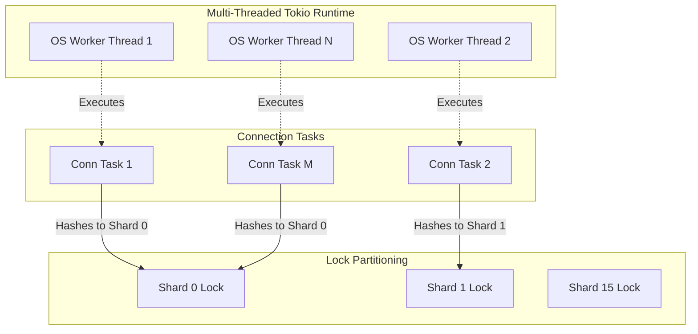
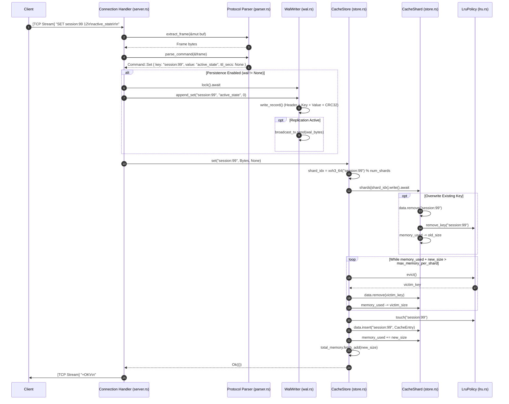
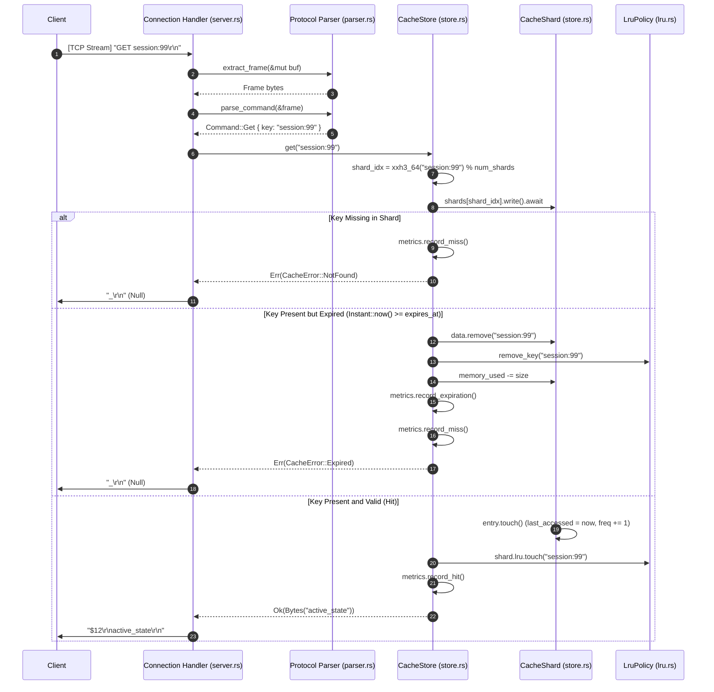
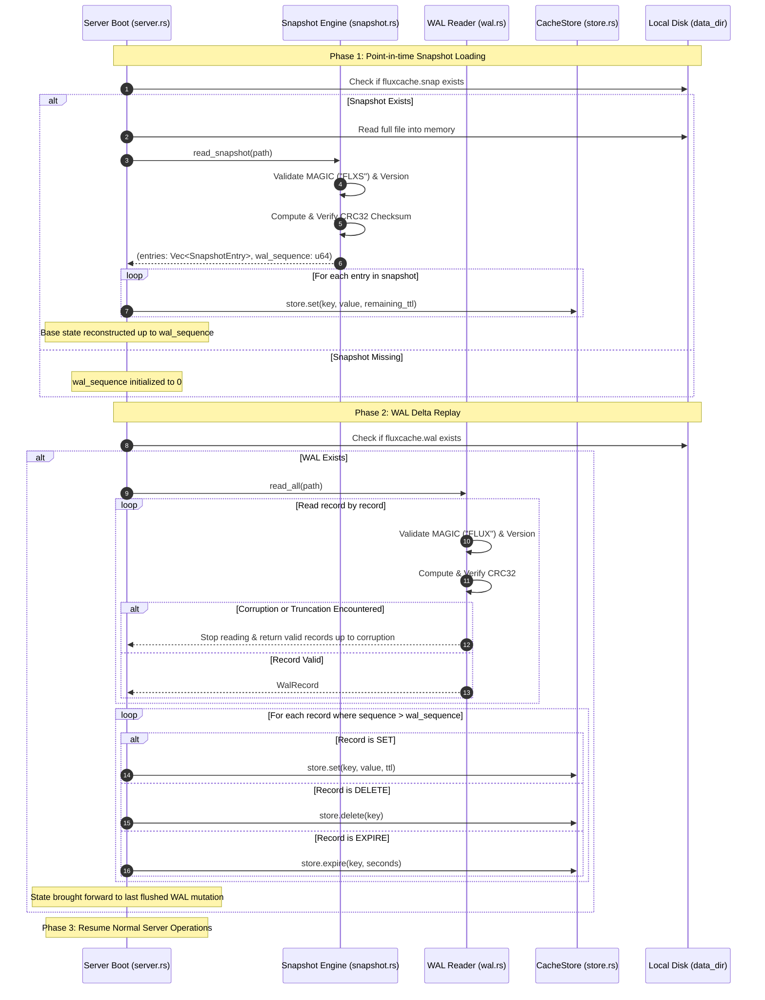
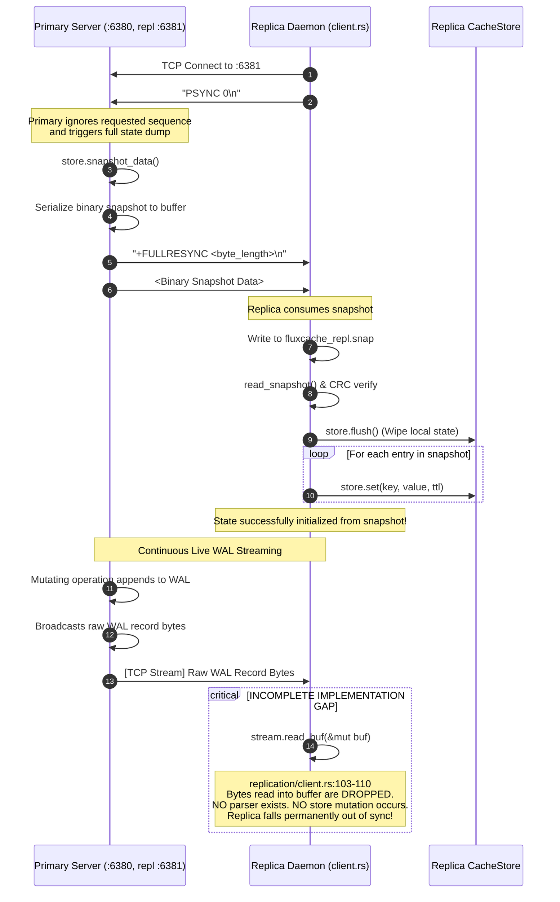

# 03 — High-Level Architecture

This document presents the reconstructed high-level architecture of **FluxCache** based entirely on source code analysis. It details subsystem boundaries, communication patterns, data flow, concurrency models, error propagation paths, and provides 5 comprehensive Mermaid diagrams.

---

## 1. System Components & Subsystem Boundaries

```mermaid
graph TB
    subgraph Client Layer
        App[Application Code]
        Cluster[ClusterClient]
        Pool[Deadpool Connection Pool]
        Ring[ConsistentHashRing BTreeMap]
        App --> Cluster
        Cluster --> Ring
        Cluster --> Pool
    end

    subgraph Network Transport Layer
        TCP_Data[TCP Data Plane :6380]
        HTTP_Admin[HTTP Admin Plane :9090]
        TCP_Repl[Replication Plane :6381]
    end

    Pool -->|Raw TCP Framed| TCP_Data
    Admin_Client[Prometheus / Operator] -->|HTTP/1.1| HTTP_Admin

    subgraph FluxCache Server Node (fluxcache)
        subgraph Server Core (server.rs)
            Listener[TcpListener Task]
            ConnTask[Connection Handler Tasks]
            AdminTask[HTTP Admin Handler]
            Shutdown[ShutdownSignal]
        end

        subgraph Protocol Engine (protocol/)
            Parser[Protocol Parser]
            Cmd[Command Enum]
            Resp[Response Encoder]
        end

        subgraph Storage Engine (cache/)
            Store[CacheStore Router]
            Shard0[CacheShard 0<br/>RwLock]
            ShardN[CacheShard N-1<br/>RwLock]
            
            subgraph Shard Internals
                Map[HashMap String, CacheEntry]
                LRU[LruPolicy Arena List]
                LFU[LfuPolicy Frequency Buckets]
                TTL[TtlTracker BTreeMap]
            end
        end

        subgraph Persistence Engine (persistence/)
            WAL[WalWriter<br/>Mutex]
            Snap[Snapshot Engine]
            WAL_File[(fluxcache.wal)]
            Snap_File[(fluxcache.snap)]
        end

        subgraph Replication Engine (replication/)
            ReplServer[ReplicationServer]
            ReplClient[ReplicationClient]
            Broadcast[Broadcast Channel]
        end

        subgraph Observability (metrics.rs)
            Metrics[CacheMetrics Atomic Counters]
        end
    end

    TCP_Data --> Listener
    Listener --> ConnTask
    ConnTask --> Parser
    Parser --> Cmd
    Cmd --> Store
    Store --> Resp
    Resp --> ConnTask

    TCP_Repl --> ReplServer
    ReplServer --> Broadcast
    WAL --> Broadcast

    Store --> Shard0
    Store --> ShardN
    Shard0 --- Map
    Shard0 --- LRU
    Shard0 --- LFU
    Shard0 --- TTL

    Cmd -->|If SET/DEL/EXPIRE| WAL
    WAL --> WAL_File
    Snap --> Snap_File
    Snap -.->|Reads state| Store

    ConnTask -.->|Record hits/misses| Metrics
    HTTP_Admin --> AdminTask
    AdminTask -.->|Scrape| Metrics
    AdminTask -.->|Snapshot command| Snap
```

---

## 2. Component Responsibilities & Communication

### 2.1 The Layers

1. **Client Layer (`fluxcache-client`)**:
   - `ClusterClient`: Computes key hash (`xxh3_64`) against a virtual node ring (`BTreeMap<u64, String>`) to select the target node.
   - `Pool`: Manages reusable TCP streams via `deadpool` to prevent socket creation overhead.
   - `Connection`: Formats ASCII/binary command frames, manages `BytesMut` read/write buffers, and parses RESP responses.

2. **Server Network Layer (`server.rs`)**:
   - `TcpListener`: Binds to `config.listen` (default `127.0.0.1:6380`) and spawns an independent, lightweight Tokio task per connection.
   - `read_timeout` & `max_request_size`: Guard against denial-of-service, slowloris attacks, and memory exhaustion.
   - Frame Extractor (`parser.rs`): Handles framed binary messages or newline-delimited ASCII strings with support for pipelining.

3. **Storage Engine (`cache/store.rs`)**:
   - `CacheStore`: Top-level facade owning `Vec<RwLock<CacheShard>>`.
   - Modulo Sharding: Maps keys to shards via `xxh3_64(key) % num_shards`.
   - Memory Enforcement: Computes shard memory pressure and triggers synchronous eviction before inserting new items.
   - Eviction Delegation: Dispatches eviction to either `LruPolicy` or `LfuPolicy`.

4. **Persistence Engine (`persistence/`)**:
   - `WalWriter`: Thread-safe append-only file writer wrapped in `Arc<Mutex<WalWriter>>`. Emits 30-byte fixed headers + payload + CRC32 checksums.
   - Periodic Sync: Background task flushes and invokes `sync_data()` based on `wal_sync_interval` (default 100ms).
   - Atomic Snapshot: Writes whole cache state into a temporary file (`.snap.tmp`), forces disk sync (`sync_all()`), and renames atomically to `fluxcache.snap`.

5. **Replication Engine (`replication/`)**:
   - Handshake: Replica issues `PSYNC <seq>`. Primary replies with `+FULLRESYNC <len>` followed by raw binary snapshot bytes.
   - Streaming: Primary broadcasts live mutations through an in-memory `tokio::sync::broadcast` channel (capacity 1024) to active replica handlers.

---

## 3. Concurrency & Threading Model

FluxCache avoids the single-threaded event loop architecture of Redis in favor of a multi-threaded, work-stealing task architecture:



### Concurrency Highlights
- **Fine-Grained Sharding**: Instead of one global lock, the keyspace is partitioned into $N$ shards (default 16). Concurrent operations accessing different shards execute completely in parallel without contention.
- **Write Lock Limitation on GET**: Notice that in `fluxcache/src/cache/store.rs:130`, `store.get()` acquires a **write lock** (`self.shards[shard_idx].write().await`) to support metadata touching and lazy expiration. Thus, concurrent reads to keys in the **same shard** serialize.
- **Lock-Free Metrics**: All operational metrics (`hits`, `misses`, `sets`, etc.) use `std::sync::atomic::AtomicU64` with `Ordering::Relaxed` (`metrics.rs:46-94`), ensuring zero lock contention on counter updates.

---

## 4. End-to-End Operation Flows

### 4.1 Diagram: Complete SET Request Flow



---

### 4.2 Diagram: Complete GET Request Flow



---

### 4.3 Diagram: Persistence & Recovery Flow



---

### 4.4 Diagram: Replication Flow & Incomplete Implementation Boundary



---

## 5. Error Propagation & Observability Architecture

### 5.1 Error Propagation Strategy
- **Client Facing**: Domain errors (`CacheError::Expired`, `CacheError::NotFound`) map cleanly to RESP responses (`Response::Null`). Severe issues (`ValueTooLarge`, `EvictionFailed`) map to RESP error strings (`Response::Error("-ERR ...\r\n")`).
- **Disk Failures**: WAL append failures immediately return an error response to the client (`server.rs:516`), preventing silent unpersisted writes. Snapshot failures are logged via `tracing::error!` but do not crash the daemon.
- **Protocol Parse Errors**: Malformed ASCII or invalid binary frames increment `metrics.request_errors`, return a `-ERR` string, clear the input buffer, and close the stream if non-recoverable.

### 5.2 Observability Plane
- **Metrics Scraping**: Prometheus metrics are served on a separate port (`admin_listen`, default `:9090`) at `/metrics` so that telemetry scrapers cannot block or consume capacity on the primary TCP cache data plane.
- **Health Probes**: `/health` and `/ready` endpoints return HTTP 200 JSON payloads for Kubernetes liveness and readiness probes.
