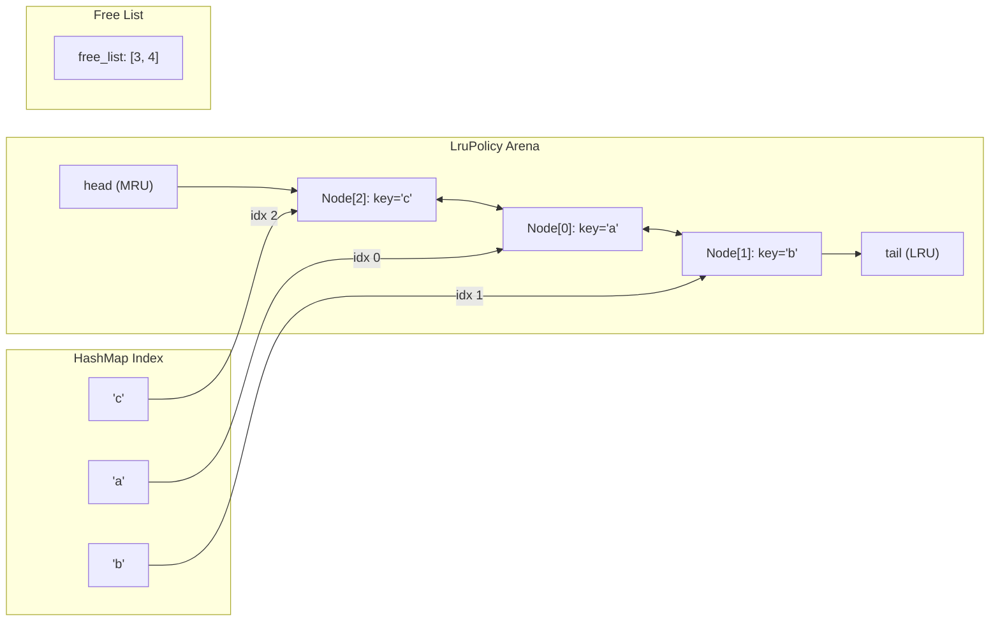

# 04 — Data & Storage Design

This document provides a deep structural and algorithmic audit of how data is represented, indexed, expired, persisted, and evicted across the **FluxCache** storage engine.

---

## 1. Verified Storage Architecture

FluxCache **does not use a relational database, SQL engine, or embedded KV library (such as RocksDB or SQLite)**.

The storage architecture is an entirely custom, multi-tier, in-memory model composed of:
1. **In-Memory Tier**: A sharded collection of standard library hash tables (`std::collections::HashMap<String, CacheEntry>`).
2. **Eviction Indexing Tier**: Intrusive arena-allocated doubly-linked lists (`LruPolicy`) and frequency-bucketed trees (`LfuPolicy`).
3. **Expiration Indexing Tier**: Time-ordered B-trees (`TtlTracker`).
4. **Durability Tier**: An append-only binary Write-Ahead Log (`fluxcache.wal`) and atomic binary snapshots (`fluxcache.snap`).

---

## 2. In-Memory Data Structures

### 2.1 Cache Entry Representation (`fluxcache/src/cache/entry.rs`)

```rust
// fluxcache/src/cache/entry.rs:9-28
#[derive(Debug, Clone)]
pub struct CacheEntry {
    pub value: Bytes,
    pub created_at: Instant,
    pub last_accessed: Instant,
    pub frequency: u64,
    pub expires_at: Option<Instant>,
    pub size: usize,
}
```

#### Fields & Purpose
- `value: Bytes`: Raw payload stored as reference-counted immutable slice. Shallow cloning takes $O(1)$ time and avoids heap reallocation during reads.
- `created_at: Instant`: Monotonic instant when the key was created (for telemetry and debugging).
- `last_accessed: Instant`: Monotonic instant updated on every touch (for LRU ordering).
- `frequency: u64`: Access counter incremented on every touch (saturating at `u64::MAX`, for LFU ordering).
- `expires_at: Option<Instant>`: Precomputed absolute expiration instant (`now + ttl`). If `None`, entry never expires.
- `size: usize`: Precomputed approximate entry size in bytes:
  $$\text{size} = \text{value.len()} + \text{std::mem::size\_of::<CacheEntry>()}$$
  *(Note: In `store.rs:170`, the key length `key.len()` is added to this value when accounting for total shard memory).*

---

### 2.2 LRU Eviction Tracker (`fluxcache/src/cache/lru.rs`)

FluxCache avoids unsafe raw pointers and avoids the double-allocation overhead of `std::collections::LinkedList` by implementing an **arena-allocated doubly-linked list** with an index-based free list.

```rust
// fluxcache/src/cache/lru.rs:17-42
type NodeIndex = usize;

#[derive(Debug)]
struct LruNode {
    key: String,
    prev: Option<NodeIndex>,
    next: Option<NodeIndex>,
    active: bool,
}

#[derive(Debug)]
pub struct LruPolicy {
    nodes: Vec<LruNode>,
    map: HashMap<String, NodeIndex>,
    head: Option<NodeIndex>,          // Most Recently Used (MRU)
    tail: Option<NodeIndex>,          // Least Recently Used (LRU victim)
    free_list: Vec<NodeIndex>,        // Recycled slots
}
```



#### Detailed Operations & Algorithmic Analysis
- **Promotion / Touch (`touch(key)`)**:
  - If `key` exists in `map`: Lookup takes $O(1)$. Calls `detach(idx)` by updating `prev.next` and `next.prev` pointers ($O(1)$). Calls `push_front(idx)` to place it at the head ($O(1)$).
  - If `key` is new: Checks `free_list.pop()`. If available, reuses that slot; otherwise pushes to `nodes` array. Inserts index into `map` and calls `push_front(idx)` ($O(1)$).
- **Eviction (`evict()`)**:
  - Reads `self.tail` ($O(1)$).
  - Extracts key name, detaches tail, marks `active = false`, pushes index to `free_list`, and deletes entry from `map` ($O(1)$).
- **Complexity**:
  - **Time**: Touch $O(1)$ expected; Evict $O(1)$; Remove $O(1)$.
  - **Space**: $O(N)$ where $N$ is tracked keys. Memory overhead per key is:
    $$\text{Overhead} = \text{sizeof(LruNode)} (\sim 48\text{B}) + \text{key string} + \text{HashMap entry} (\sim 32\text{B}) + \text{NodeIndex} (8\text{B})$$
- **Limitations**: The `nodes: Vec<LruNode>` arena grows to high-water mark capacity. Evicted slots are returned to `free_list`, but the underlying `Vec` capacity is never truncated/shrunk, retaining memory until process exit.

---

### 2.3 LFU Eviction Tracker with Frequency Decay (`fluxcache/src/cache/lfu.rs`)

```rust
// fluxcache/src/cache/lfu.rs:13-23
#[derive(Debug)]
pub struct LfuPolicy {
    key_freq: HashMap<String, u64>,
    freq_keys: BTreeMap<u64, HashSet<String>>,
    access_count: u64,
    decay_interval: u64,
}
```

```mermaid
graph LR
    subgraph Frequency Buckets (BTreeMap)
        Freq1["Freq 1"] --> Set1["HashSet: {'cold_key', 'new_key'}"]
        Freq2["Freq 2"] --> Set2["HashSet: {'warm_key'}"]
        Freq50["Freq 50"] --> Set3["HashSet: {'hot_key'}"]
    end

    subgraph Reverse Lookup
        KeyFreq["key_freq: HashMap<String, u64>"]
    end
```

#### Detailed Operations & Algorithmic Analysis
- **Touch (`touch(key)`)**:
  - Increments `access_count`.
  - Removes `key` from its old frequency bucket `freq_keys.get_mut(&old_freq)`.
  - Inserts `key` into `new_freq = old_freq + 1` bucket.
  - Updates `key_freq`.
  - If `access_count >= decay_interval` (default 10,000), triggers `self.decay()`.
- **Decay Pass (`decay()`)**:
  - Iterates through all entries in `key_freq`, halving their frequencies:
    $$\text{new\_freq} = \max(1, \text{old\_freq} / 2)$$
  - Reconstructs the entire `BTreeMap<u64, HashSet<String>>`.
- **Eviction (`evict()`)**:
  - Queries `self.freq_keys.keys().next()` to obtain the lowest frequency bucket in $O(1)$ / $O(\log F)$.
  - Picks an arbitrary key from the bucket's `HashSet` and removes it.
- **Complexity**:
  - **Time**:
    - Normal Touch: $O(\log F)$ where $F$ is the count of unique frequencies.
    - Eviction: $O(\log F)$.
    - **Decay Spike**: $O(N \log F)$ where $N$ is total keys in cache! Occurs once every `decay_interval` operations, causing periodic p99/p99.9 latency spikes under sustained load.
  - **Space**: $O(N)$ with duplicated key strings in both `key_freq` and `freq_keys`.

---

### 2.4 TTL Expiration Tracker (`fluxcache/src/cache/ttl.rs`)

```rust
// fluxcache/src/cache/ttl.rs:17-23
#[derive(Debug)]
pub struct TtlTracker {
    expirations: BTreeMap<Instant, Vec<String>>,
    key_expiry: HashMap<String, Instant>,
}
```

#### Operations & Algorithmic Analysis
- **Registration (`set_expiry(key, expires_at)`)**:
  - Removes any existing expiry for `key` via reverse index `key_expiry`.
  - Pushes `key` into `expirations.entry(expires_at).or_default().push(key)` ($O(\log T)$ where $T$ is unique expiration timestamps).
- **Active Scanning (`collect_expired(now, max_batch)`)**:
  - Traverses `expirations` from earliest timestamp until `exp_time > now`.
  - Collects up to `max_batch` keys and returns them for deletion.
- **Critical Complexity Finding**:
  - In `ttl.rs:92-97`, if `collect_expired` hits `max_batch` mid-bucket, it executes:
    ```rust
    for key in &expired {
        for keys in self.expirations.values_mut() {
            keys.retain(|k| k != key);
        }
    }
    ```
  - This nested loop scans **all remaining buckets** in the BTreeMap for every expired key, resulting in an $O(B_{\text{expired}} \times T_{\text{remaining}} \times K_{\text{bucket}})$ operation! This represents a major algorithmic inefficiency when many keys expire at the same instant.

---

### 2.5 Memory Accounting & Sharding Model

#### Shard Partitioning (`fluxcache/src/cache/store.rs`)
```rust
pub struct CacheStore {
    shards: Vec<RwLock<CacheShard>>,
    num_shards: usize,
    max_memory_per_shard: usize,
    max_memory: usize,
    total_memory: AtomicUsize,
    ...
}
```

```mermaid
graph TD
    Key["Key: 'user:session:100'"] --> Hash["xxh3_64('user:session:100')"]
    Hash --> Mod["hash % 16 (num_shards)"]
    Mod --> Shard["Target: Shard 4"]
    
    subgraph Shard 4 (Guarded by RwLock)
        Mem["memory_used: 14.2 MB / 16 MB"]
        Store4["data: HashMap"]
        LRU4["lru: LruPolicy"]
        TTL4["ttl: TtlTracker"]
    end
    Shard --> Shard 4
```

#### Memory Accounting Mechanics
1. **Per-Shard Budget**:
   $$\text{max\_memory\_per\_shard} = \frac{\text{max\_memory}}{\text{num\_shards}}$$
   With `max_memory = 256MB` and `shards = 16`, each shard has a hard limit of `16MB`.
2. **Heuristic Estimation**:
   $$\text{entry\_size} = \text{key.len()} + \text{value.len()} + \text{std::mem::size\_of::<CacheEntry>()}$$
   - Does **not** include heap metadata for `HashMap` buckets, `LruPolicy` arena nodes, `TtlTracker` nodes, or jemalloc memory page fragmentation.
3. **Shard Eviction Independence**:
   - Eviction occurs strictly inside the shard mapped by the incoming key.
   - If Shard 4 reaches 16MB, it evicts its own oldest key immediately, even if Shards 0 through 3 are 100% empty!

---

## 3. On-Disk Persistence File Formats

### 3.1 Write-Ahead Log (WAL) Binary Format (`fluxcache/src/persistence/wal.rs`)

WAL files (`fluxcache.wal`) consist of sequential, variable-length binary records. There is no file-level header; every record begins with magic bytes.

#### Record Binary Layout

```text
 0                   1                   2                   3
 0 1 2 3 4 5 6 7 8 9 0 1 2 3 4 5 6 7 8 9 0 1 2 3 4 5 6 7 8 9 0 1
+-+-+-+-+-+-+-+-+-+-+-+-+-+-+-+-+-+-+-+-+-+-+-+-+-+-+-+-+-+-+-+-+
|                       MAGIC: 0x464C5558                       | ("FLUX")
+-+-+-+-+-+-+-+-+-+-+-+-+-+-+-+-+-+-+-+-+-+-+-+-+-+-+-+-+-+-+-+-+
|    VERSION    |               SEQUENCE NUMBER                 |
|     (0x01)    |                   (8 bytes)                   |
+-+-+-+-+-+-+-+-+-+-+-+-+-+-+-+-+-+-+-+-+-+-+-+-+-+-+-+-+-+-+-+-+
|     ...       |  RECORD TYPE  |          KEY LENGTH           |
|  (seq cont.)  | 1=SET,2=DEL,3 |           (4 bytes)           |
+-+-+-+-+-+-+-+-+-+-+-+-+-+-+-+-+-+-+-+-+-+-+-+-+-+-+-+-+-+-+-+-+
|          VALUE LENGTH         |            TTL SECS           |
|            (4 bytes)          |           (8 bytes)           |
+-+-+-+-+-+-+-+-+-+-+-+-+-+-+-+-+-+-+-+-+-+-+-+-+-+-+-+-+-+-+-+-+
|              ...              |          KEY BYTES            |
|          (ttl cont.)          |        (key_len bytes)        |
+-+-+-+-+-+-+-+-+-+-+-+-+-+-+-+-+-+-+-+-+-+-+-+-+-+-+-+-+-+-+-+-+
|          VALUE BYTES (if value_len > 0, val_len bytes)        |
+-+-+-+-+-+-+-+-+-+-+-+-+-+-+-+-+-+-+-+-+-+-+-+-+-+-+-+-+-+-+-+-+
|                       CHECKSUM (CRC32)                        |
|                           (4 bytes)                           |
+-+-+-+-+-+-+-+-+-+-+-+-+-+-+-+-+-+-+-+-+-+-+-+-+-+-+-+-+-+-+-+-+
```

| Field | Type | Size | Description |
|---|---|---|---|
| `MAGIC` | `[u8; 4]` | 4 bytes | Fixed constant: `0x46, 0x4C, 0x55, 0x58` (`"FLUX"`) |
| `VERSION` | `u8` | 1 byte | Format version: `0x01` |
| `SEQUENCE` | `u64` (big-endian) | 8 bytes | Monotonically increasing mutation sequence number |
| `RECORD_TYPE` | `u8` | 1 byte | `1` = `Set`, `2` = `Delete`, `3` = `Expire` |
| `KEY_LENGTH` | `u32` (big-endian) | 4 bytes | Length of UTF-8 key string in bytes |
| `VALUE_LENGTH`| `u32` (big-endian) | 4 bytes | Length of binary value in bytes (`0` for Delete/Expire) |
| `TTL_SECS` | `u64` (big-endian) | 8 bytes | Expiration duration in seconds (`0` if no TTL) |
| `KEY` | Raw Bytes | `key_len` | Key payload |
| `VALUE` | Raw Bytes | `value_len` | Value payload |
| `CHECKSUM` | `u32` (big-endian) | 4 bytes | CRC32 checksum calculated over all preceding bytes in record |

---

### 3.2 Snapshot Binary Format (`fluxcache/src/persistence/snapshot.rs`)

Point-in-time snapshots (`fluxcache.snap`) store a complete image of all non-expired cache entries across all shards.

#### File Binary Layout

```text
 0                   1                   2                   3
 0 1 2 3 4 5 6 7 8 9 0 1 2 3 4 5 6 7 8 9 0 1 2 3 4 5 6 7 8 9 0 1
+-+-+-+-+-+-+-+-+-+-+-+-+-+-+-+-+-+-+-+-+-+-+-+-+-+-+-+-+-+-+-+-+
|                       MAGIC: 0x464C5853                       | ("FLXS")
+-+-+-+-+-+-+-+-+-+-+-+-+-+-+-+-+-+-+-+-+-+-+-+-+-+-+-+-+-+-+-+-+
|    VERSION    |                  ENTRY COUNT                  |
|     (0x01)    |                   (8 bytes)                   |
+-+-+-+-+-+-+-+-+-+-+-+-+-+-+-+-+-+-+-+-+-+-+-+-+-+-+-+-+-+-+-+-+
|      ...      |               WAL SEQUENCE NUMBER             |
| (count cont.) |                   (8 bytes)                   |
+-+-+-+-+-+-+-+-+-+-+-+-+-+-+-+-+-+-+-+-+-+-+-+-+-+-+-+-+-+-+-+-+
|      ...      |               ENTRIES REPEATED...             |
|  (seq cont.)  |                                               |
+-+-+-+-+-+-+-+-+-+-+-+-+-+-+-+-+-+-+-+-+-+-+-+-+-+-+-+-+-+-+-+-+
|                                                               |
| Entry: [KEY_LEN: u32][VAL_LEN: u32][TTL_REMAINING_SECS: u64]  |
|        [KEY: key_len bytes][VALUE: val_len bytes]             |
|                                                               |
+-+-+-+-+-+-+-+-+-+-+-+-+-+-+-+-+-+-+-+-+-+-+-+-+-+-+-+-+-+-+-+-+
|                       CHECKSUM (CRC32)                        |
|             (4 bytes, covers entire file header + entries)    |
+-+-+-+-+-+-+-+-+-+-+-+-+-+-+-+-+-+-+-+-+-+-+-+-+-+-+-+-+-+-+-+-+
```

---

## 4. Comprehensive Data Structure Comparison

| Data Structure | Module | Primary Operations | Time Complexity | Space Complexity | Concurrency Protection | Architectural Bottleneck / Limitation |
|---|---|---|---|---|---|---|
| **`CacheStore`** | `cache/store.rs` | `get()`, `set()`, `delete()`, `expire()` | $O(1)$ expected | $O(N)$ entries | Partitioned `Vec<RwLock<CacheShard>>` | `get()` takes exclusive write lock on shard; memory limits enforced per-shard rather than globally. |
| **`LruPolicy`** | `cache/lru.rs` | `touch()`, `evict()`, `remove_key()` | $O(1)$ worst-case | $O(N)$ entries | Protected by parent `CacheShard` lock | Arena `Vec` capacity never shrinks after allocations; slot reuse only via `free_list`. |
| **`LfuPolicy`** | `cache/lfu.rs` | `touch()`, `evict()`, `decay()` | Touch: $O(\log F)$<br>Decay: $O(N \log F)$ | $O(N)$ entries | Protected by parent `CacheShard` lock | Periodic `decay()` halts operations on that shard to rebuild entire BTreeMap over all keys. |
| **`TtlTracker`** | `cache/ttl.rs` | `set_expiry()`, `collect_expired()` | Set: $O(\log T)$<br>Scan: $O(K \cdot T)$ worst | $O(N)$ entries | Protected by parent `CacheShard` lock | Mid-bucket scan cleanup triggers quadratic scan across remaining BTreeMap value arrays (`ttl.rs:95`). |
| **`ConsistentHashRing`** | `shard/consistent_hash.rs` | `add_node()`, `get_node()` | Lookup: $O(\log(V \cdot N))$<br>Add: $O(V \log(V \cdot N))$ | $O(V \cdot N)$ points | Immutable after construction (or single-threaded) | Binary search over contiguous sorted array; dynamic node removal scans entire array (`retain`). |
| **`SingleflightGroup`** | `singleflight/mod.rs` | `do_work()` | $O(1)$ expected | $O(K_{\text{in-flight}})$ | `tokio::sync::Mutex<HashMap<String, InFlight>>` | Unused in server data plane (`server.rs`); only tested in unit tests. |
