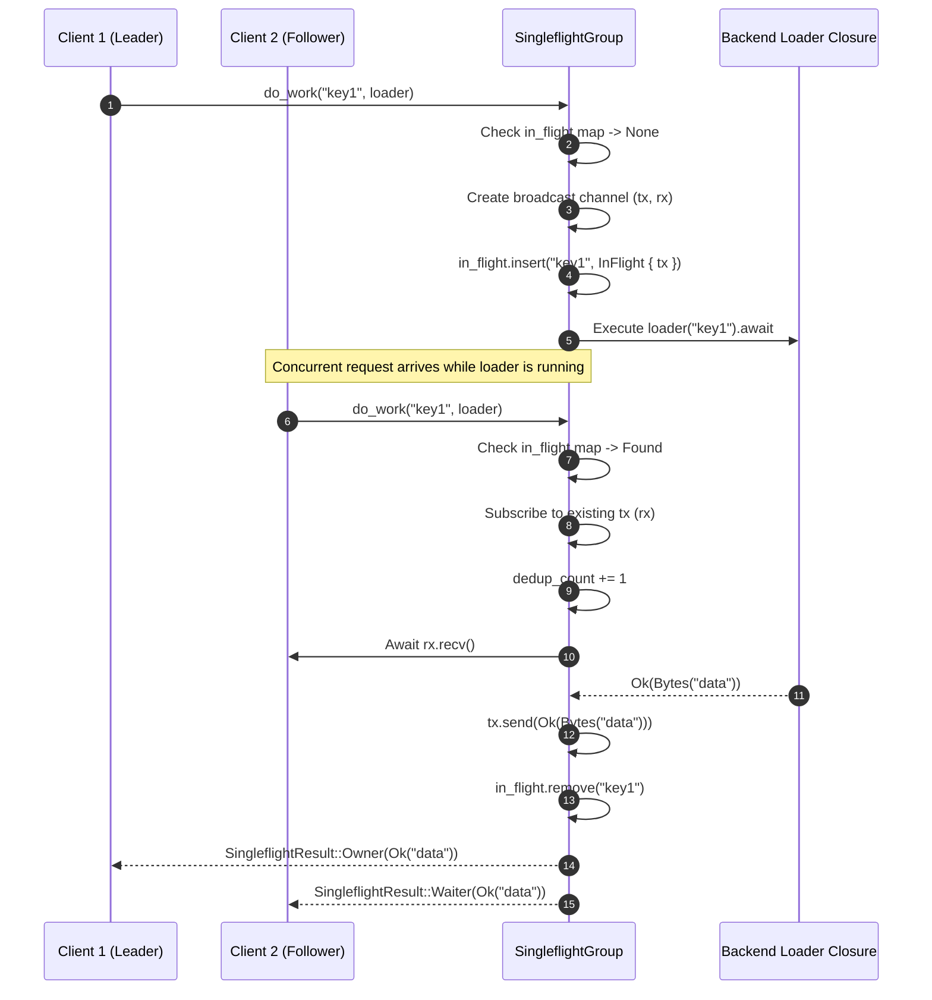
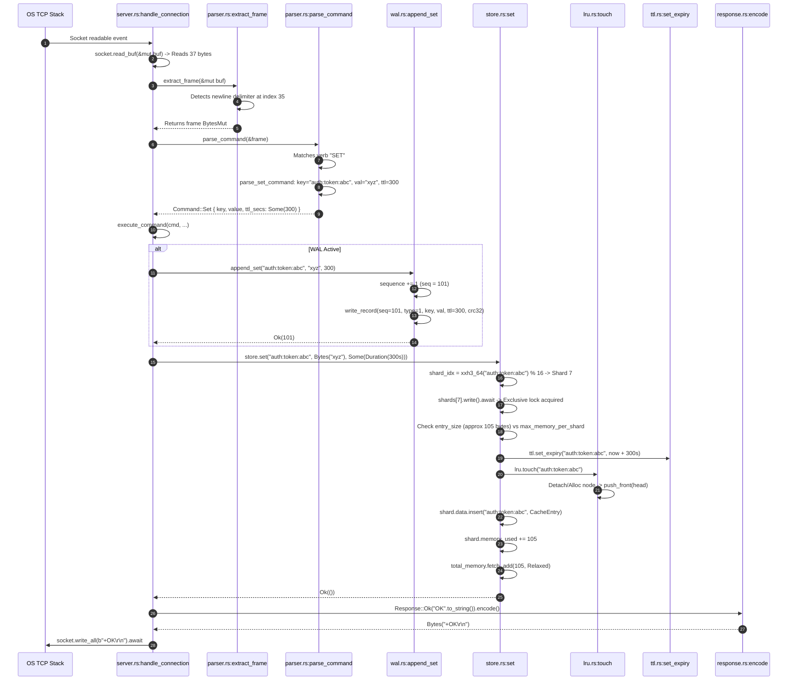

# 05 — Low-Level Design (LLD)

> **Priority Phase**: This document contains the exhaustive low-level design audit of the FluxCache implementation. It dissects every struct, field, enum, and method, explains the ownership and synchronization model, diagrams component relationships, and traces operations from the public TCP interface down to memory mutations.

---

## 1. Class & Component Relationship Diagram

```mermaid
classDiagram
    direction TB

    class FluxServer {
        -config: Config
        -store: Arc~CacheStore~
        -metrics: Arc~CacheMetrics~
        -shutdown: ShutdownSignal
        -wal: Option~Arc~Mutex~WalWriter~~~
        -wal_broadcast: Option~broadcast::Sender~Bytes~~
        +new(config: Config) Result~Self~
        +run() Result~()~
        -spawn_tcp_server()
        -spawn_admin_server()
        -spawn_expiration_task()
        -spawn_wal_sync_task()
        -spawn_snapshot_task()
        -take_snapshot()
    }

    class CacheStore {
        -shards: Vec~RwLock~CacheShard~~
        -num_shards: usize
        -max_memory_per_shard: usize
        -max_memory: usize
        -eviction_policy: EvictionPolicy
        -total_memory: AtomicUsize
        -metrics: Arc~CacheMetrics~
        +get(key: &str) CacheResult~Bytes~
        +set(key: String, value: Bytes, ttl: Option~Duration~) CacheResult~()~
        +delete(key: &str) bool
        +exists(key: &str) bool
        +expire(key: &str, seconds: u64) bool
        +ttl(key: &str) Option~Option~u64~~
        +expire_scan(max_per_shard: usize) usize
        +flush()
        +stats() CacheStats
        +snapshot_data() Vec~(String, Bytes, Option~u64~)~
        -shard_index(key: &str) usize
        -evict_one(shard: &mut CacheShard) bool
    }

    class CacheShard {
        -data: HashMap~String, CacheEntry~
        -lru: LruPolicy
        -lfu: LfuPolicy
        -ttl: TtlTracker
        -memory_used: usize
        ~new() Self
    }

    class CacheEntry {
        +value: Bytes
        +created_at: Instant
        +last_accessed: Instant
        +frequency: u64
        +expires_at: Option~Instant~
        +size: usize
        +new(value: Bytes, ttl: Option~Duration~) Self
        +is_expired() bool
        +touch()
        +set_ttl(ttl: Duration)
        +clear_ttl()
        +remaining_ttl() Option~u64~
    }

    class LruPolicy {
        -nodes: Vec~LruNode~
        -map: HashMap~String, usize~
        -head: Option~usize~
        -tail: Option~usize~
        -free_list: Vec~usize~
        +touch(key: &str)
        +evict() Option~String~
        +remove_key(key: &str)
        +peek_lru() Option~&str~
        -alloc_node(key: String) usize
        -detach(idx: usize)
        -push_front(idx: usize)
    }

    class LfuPolicy {
        -key_freq: HashMap~String, u64~
        -freq_keys: BTreeMap~u64, HashSet~String~~
        -access_count: u64
        -decay_interval: u64
        +touch(key: &str)
        +evict() Option~String~
        +remove_key(key: &str)
        +frequency(key: &str) Option~u64~
        -decay()
    }

    class TtlTracker {
        -expirations: BTreeMap~Instant, Vec~String~~
        -key_expiry: HashMap~String, Instant~
        +set_expiry(key: String, expires_at: Instant)
        +remove_expiry(key: &str)
        +collect_expired(now: Instant, max_batch: usize) Vec~String~
        +is_expired(key: &str, now: Instant) bool
    }

    class WalWriter {
        -writer: BufWriter~File~
        -sequence: u64
        -path: PathBuf
        -bytes_written: u64
        -broadcast_tx: Option~broadcast::Sender~Bytes~~
        +open(path: &Path, broadcast_tx: Option~broadcast::Sender~Bytes~~) Result~Self~
        +append_set(key: &str, value: &[u8], ttl_secs: u64) Result~u64~
        +append_delete(key: &str) Result~u64~
        +append_expire(key: &str, ttl_secs: u64) Result~u64~
        +sync() Result~()~
        -write_record(record: &WalRecord) Result~()~
    }

    class SingleflightGroup {
        -in_flight: Mutex~HashMap~String, InFlight~~
        -dedup_count: AtomicU64
        +do_work(key: &str, loader: F) SingleflightResult
        +dedup_count() u64
    }

    class ConsistentHashRing {
        -ring: Vec~RingPoint~
        -virtual_nodes: usize
        -nodes: Vec~String~
        +add_node(node_id: &str)
        +remove_node(node_id: &str)
        +get_node(key: &str) Option~&str~
        +get_nodes(key: &str, count: usize) Vec~&str~
    }

    FluxServer *-- CacheStore
    FluxServer *-- WalWriter
    CacheStore *-- CacheShard : 16 shards
    CacheShard *-- CacheEntry : 1:N
    CacheShard *-- LruPolicy
    CacheShard *-- LfuPolicy
    CacheShard *-- TtlTracker
```

---

## 2. In-Depth Subsystem LLD

### 2.1 Storage Engine: `CacheStore` & `CacheShard` (`src/cache/store.rs`)

#### 1. Responsibility
The core storage coordinator. Responsible for partitioning keys into shards, acquiring fine-grained shard locks, checking capacity, coordinating eviction when memory limits are reached, and delegating reads/writes to individual shard instances.

#### 2. Key Structs & Definitions
```rust
// fluxcache/src/cache/store.rs:52-75
struct CacheShard {
    data: HashMap<String, CacheEntry>,
    lru: LruPolicy,
    lfu: LfuPolicy,
    ttl: TtlTracker,
    memory_used: usize,
}

// fluxcache/src/cache/store.rs:78-93
pub struct CacheStore {
    shards: Vec<RwLock<CacheShard>>,
    num_shards: usize,
    max_memory_per_shard: usize,
    max_memory: usize,
    eviction_policy: EvictionPolicy,
    total_memory: AtomicUsize,
    metrics: Arc<CacheMetrics>,
}
```

#### 3. Field Rationale
- `shards`: A vector of independently locked shards. Partitioning eliminates a single global lock bottleneck.
- `num_shards`: Number of partitions (default 16). Sized to exceed the number of CPU cores to minimize collision probability.
- `max_memory_per_shard`: Calculated as `max_memory / num_shards`. Enforces memory ceilings locally within each shard.
- `total_memory`: `AtomicUsize` tracking global memory consumption across all shards using `Relaxed` atomics.
- `memory_used` (in `CacheShard`): Shard-local non-atomic running sum of bytes used by entries. Protected by the shard's `RwLock`.

#### 4. Critical Methods & Locking Mechanics
- `shard_index(&self, key: &str) -> usize`:
  Computes `(xxh3_64(key.as_bytes()) as usize) % self.num_shards`.
- `get(&self, key: &str) -> CacheResult<Bytes>`:
  - **Locks acquired**: **Exclusive Write Lock** via `self.shards[shard_idx].write().await`.
  - **Why Write Lock?**:
    1. If the entry is expired (`entry.is_expired()`), it must be removed (`shard.data.remove(key)`) along with its eviction metadata.
    2. If the entry is valid, `entry.touch()` mutates `last_accessed` and `frequency`.
    3. The eviction tracker (`shard.lru.touch(key)` or `shard.lfu.touch(key)`) requires mutating linked-list pointers or B-tree buckets.
  - **Consequence**: Two concurrent readers requesting keys belonging to the same shard **block each other**.
- `set(&self, key: String, value: Bytes, ttl: Option<Duration>) -> CacheResult<()>`:
  - Validates `entry_size <= self.max_memory_per_shard`. Returns `CacheError::ValueTooLarge` if a single key exceeds the entire shard quota.
  - Acquires shard write lock.
  - If key already exists: removes old entry, deducts its size from `shard.memory_used` and `self.total_memory`, and cleans up eviction/TTL references.
  - **Eviction Loop**: While `shard.memory_used + entry_size > self.max_memory_per_shard`, repeatedly calls `self.evict_one(&mut shard)`. If eviction fails or returns `false` (e.g., policy is `None`), returns `CacheError::EvictionFailed`.
  - Registers TTL in `shard.ttl` if expiration is configured.
  - Promotes key in `shard.lru` or `shard.lfu`.
  - Updates memory counters and inserts entry into `shard.data`.
- `evict_one(&self, shard: &mut CacheShard) -> bool`:
  - Dispatches to `shard.lru.evict()` or `shard.lfu.evict()`.
  - On receiving victim key, removes it from `shard.data`, decrements memory, removes TTL registration, and cleans up the alternate eviction policy tracker.

---

### 2.2 Eviction Subsystem: `LruPolicy` & `LfuPolicy`

#### 1. `LruPolicy` (`src/cache/lru.rs`)
- **Arena Design**: Uses `Vec<LruNode>` as an object pool. Nodes point to other nodes via `Option<usize>` arena indices (`prev`, `next`).
- **Free List**: When a key is evicted or removed, its slot index is pushed onto `free_list: Vec<usize>`. Future insertions reuse slots from `free_list` via `.pop()`, preventing unbounded array growth under stable key counts.
- **Complexity**: All operations (`touch`, `evict`, `remove_key`) run in $O(1)$ worst-case time with zero heap allocations on hot paths (assuming slots exist in `free_list`).

#### 2. `LfuPolicy` (`src/cache/lfu.rs`)
- **Bucket Design**: `freq_keys: BTreeMap<u64, HashSet<String>>`. Keys with the exact same access count are grouped in a `HashSet`.
- **Decay Mechanism**: Prevents historical "hot keys" from remaining immortal in the cache. Every `decay_interval` (default 10,000 accesses), `self.decay()` is invoked:
  - Frequencies are halved: $\max(1, \text{freq} / 2)$.
  - Entire `BTreeMap` is rebuilt from scratch.
  - **Trade-off**: Halts the shard during decay ($O(N \log F)$ CPU freeze).

---

### 2.3 Expiration Subsystem: `TtlTracker` (`src/cache/ttl.rs`)

- **Dual-Mode Expiration**:
  1. **Passive / Lazy Expiration**: Triggered inside `store.get()` (`store.rs:134`). If `Instant::now() >= exp`, the key is evicted on-demand during read.
  2. **Active Background Scanning**: Triggered periodically by a dedicated background task (`server.rs:313`). Calls `store.expire_scan(1000)` every `expiration_scan_interval` (default 1,000ms), which iterates through all shards, collecting up to 1,000 expired keys per shard from `TtlTracker::collect_expired()`.
- **Data Structure**:
  - `expirations: BTreeMap<Instant, Vec<String>>`: Time-sorted buckets of expiring keys.
  - `key_expiry: HashMap<String, Instant>`: Reverse map used to locate and update a key's expiration instant in $O(1)$.

---

### 2.4 Persistence Subsystem: `WalWriter` & `Snapshot` (`src/persistence/`)

#### 1. Write-Ahead Logging (`wal.rs`)
- **Structure**: Wraps `std::io::BufWriter<std::fs::File>`.
- **Mutation Path**: Every `SET`, `DEL`, or `EXPIRE` command formats a `WalRecord` and writes it sequentially before updating the in-memory `CacheStore`.
- **Sync Model**: Writes are buffered in user-space RAM (`BufWriter`). The background task spawned in `server.rs:335` flushes and issues `sync_data()` every `wal_sync_interval` (default 100ms).
- **Checksumming**: CRC32 computed over header and payload. Appended as the final 4 bytes of each record.
- **Crash Recovery (`WalReader::read_all`)**: Scans records sequentially. If a record contains invalid magic bytes, unsupported versions, CRC32 mismatches, or unexpected EOF (truncated tail), reader logs a warning and **returns all records up to the corruption point**.

#### 2. Snapshots (`snapshot.rs`)
- **Mechanism**:
  1. `store.snapshot_data().await` extracts all live, non-expired keys and values across all shards.
  2. Serializes data to `<path>.tmp` with a 21-byte header, length-prefixed entries, and trailing CRC32 checksum.
  3. Invokes `file.sync_all()?` to guarantee disk persistence.
  4. Calls `std::fs::rename(&tmp_path, path)?` to perform an **atomic filesystem swap**.
  - **Advantage**: If power is cut mid-snapshot, the existing `.snap` file remains untouched and uncorrupted.

---

### 2.5 Request Coalescing: `SingleflightGroup` (`src/singleflight/mod.rs`)

#### 1. Responsibility
Mitigates cache stampedes (thundering herd problem) by coalescing concurrent in-flight requests for the same missing key so that only a single loader executes.

#### 2. Struct Implementation
```rust
// fluxcache/src/singleflight/mod.rs:49-64
struct InFlight {
    tx: broadcast::Sender<Result<Bytes, String>>,
}

pub struct SingleflightGroup {
    in_flight: Mutex<HashMap<String, InFlight>>,
    dedup_count: std::sync::atomic::AtomicU64,
}
```

#### 3. Execution Mechanics (`do_work`)


#### 4. Critical Architecture Verification Finding
While `SingleflightGroup` is fully implemented and tested with 5 unit tests (`test_concurrent_deduplication`, `test_failed_request_does_not_poison`, etc.), **it is not integrated into `server.rs` or `store.rs`**. FluxCache currently operates as a pure cache without an external database fetch mechanism. The diagram in `README.md:33-47` describing `GET_OR_LOAD` represents an intended API feature rather than an active server command.

---

### 2.6 Distributed Routing: `ConsistentHashRing` (`src/shard/consistent_hash.rs`)

#### 1. Implementation
- **Virtual Nodes**: Each physical node is cloned into `virtual_nodes` (default 150) ring points formatted as `"{node_id}:vn{i}"`.
- **Ring Storage**: `ring: Vec<RingPoint>` maintained in ascending sorted order by `hash: u64` (`xxh3_64`).
- **Lookup (`get_node`)**:
  - Computes `hash = xxh3_64(key.as_bytes())`.
  - Performs binary search: `ring.binary_search_by_key(&hash, |p| p.hash)`.
  - If no exact match, takes the insertion point index (first point clockwise). If the index exceeds the array bounds, wraps around to index 0.
  - **Complexity**: $O(\log(V \times N))$ where $N$ is physical nodes and $V$ is virtual nodes.

---

### 2.7 Replication Subsystem: `ReplicationServer` & `ReplicationClient`

#### 1. Protocol (`src/replication/protocol.rs`)
- `PSYNC <seq>\n`: Replica request to synchronize state.
- `+FULLRESYNC <len>\n<binary snapshot data>`: Primary response delivering full memory dump.

#### 2. Primary Daemon (`src/replication/server.rs`)
- Listens on `--replication-listen` (default `127.0.0.1:6381`).
- On replica connection, generates an in-memory snapshot (`store.snapshot_data()`), prefixes with `+FULLRESYNC`, and writes to socket.
- Subscribes to `wal_broadcast: broadcast::Sender<Bytes>` and forwards raw WAL mutations to the replica socket. If the replica lags (`RecvError::Lagged`), the primary disconnects the replica to force a full resync.

#### 3. Replica Daemon (`src/replication/client.rs`)
- Connects to primary, receives `+FULLRESYNC`, dumps to `fluxcache_repl.snap`, parses snapshot, flushes local store (`store.flush()`), and populates entries.
- **Incomplete Implementation Boundary**: At line 102 (`client.rs:102-110`), the continuous WAL read loop reads bytes into `buf` but lacks the decoding logic to replay them against `self.store`.

---

## 3. Comprehensive End-to-End Operation Trace

Let us trace a command: `SET auth:token:abc "xyz" EX 300` sent by a client.


