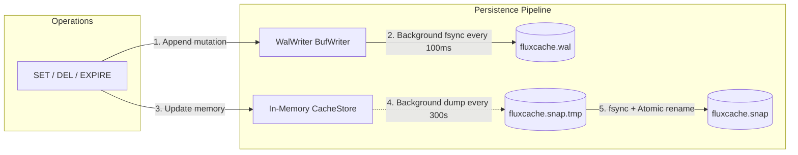
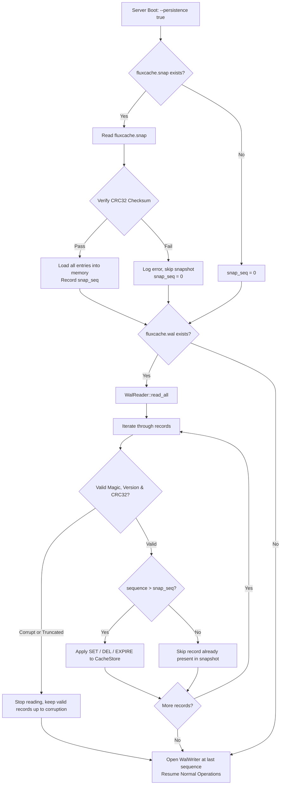

# 07 — Persistence, Reliability & Distributed Systems

This document provides a rigorous systems-level analysis of **FluxCache's** durability guarantees, crash recovery semantics, distributed topology, replication protocols, and behavior during specific infrastructure failure scenarios.

---

## 1. Persistence & Durability Architecture

FluxCache implements a **hybrid dual-tier persistence model** consisting of a Write-Ahead Log (WAL) and periodic point-in-time binary Snapshots.

---

## 2. Durability Guarantees & Sync Intervals

### 2.1 The Durability Window
When `--persistence true` is enabled, mutations are written sequentially to the WAL.
- **Write Path**: `wal.append_set()` appends bytes to a user-space memory buffer (`std::io::BufWriter`).
- **Sync Interval**: `server.rs:335-356` spawns a background task executing `wal.sync()` every `--wal-sync-interval-ms` (default **100ms**).
- **The Guarantee**: FluxCache guarantees **at most 100ms of data loss** upon sudden ungraceful power loss or OS crash.
- **Synchronous Write-to-Disk Option**: FluxCache does **not** provide an `fsync-on-every-write` mode (similar to Redis `appendfsync always`). Every write command completes as soon as it is buffered in user space.

### 2.2 Data Integrity & Corruption Protection
- **Checksumming**: Every WAL record ends with a 4-byte CRC32 checksum computed over its 30-byte header and variable payload. Every snapshot ends with a 4-byte CRC32 checksum computed over the entire file.
- **Atomic Snapshots**: Snapshots are written to a temporary sibling file (`fluxcache.snap.tmp`), forced to disk via `file.sync_all()`, and swapped into place using POSIX atomic `std::fs::rename`. An interrupted snapshot write will never corrupt an existing snapshot file.

---

## 3. Crash Recovery Protocol

During server initialization (`server.rs:56-128`), FluxCache executes a deterministic, two-phase crash recovery protocol:

### 2.3 Recovery Guarantees
1. **Deterministic State Replay**: Any mutation whose sequence number is $\le \text{snap\_seq}$ is ignored, preventing duplicate processing or overwriting fresher data.
2. **Corrupted Tail Tolerant**: If an operating system crash truncated the last WAL record mid-write, `WalReader` identifies `UnexpectedEof` or `ChecksumMismatch`, logs a warning (`wal.rs:258-272`), and cleanly stops recovery at the last known healthy record.

---

## 4. Distributed Systems & Replication Analysis

### 4.1 Topology
FluxCache uses a **Single-Primary, Multi-Replica** asynchronous replication topology with client-side consistent hash partitioning across primary nodes.

```mermaid
graph TD
    subgraph Client Application
        Client[ClusterClient]
    end

    subgraph Sharded Cache Cluster
        subgraph Partition 1
            PrimaryA[Primary Node A<br/>:6380 / :6381]
            ReplicaA[Replica Node A<br/>:6382]
            PrimaryA -.->|Async Replication| ReplicaA
        end

        subgraph Partition 2
            PrimaryB[Primary Node B<br/>:6380 / :6381]
            ReplicaB[Replica Node B<br/>:6382]
            PrimaryB -.->|Async Replication| ReplicaB
        end
    end

    Client -->|xxh3_64 Consistent Hash| PrimaryA
    Client -->|xxh3_64 Consistent Hash| PrimaryB
```

### 4.2 Replication Mechanics
1. **Handshake**: The replica connects to the primary's `--replication-listen` port (`127.0.0.1:6381`) and transmits `PSYNC <seq>\n`.
2. **Full Resynchronization (`+FULLRESYNC`)**:
   - The primary dumps an in-memory snapshot (`store.snapshot_data()`), wraps it in a `+FULLRESYNC <len>\n` frame, and transmits it across the TCP stream.
   - The replica saves the snapshot, wipes its existing in-memory store (`store.flush()`), and loads all entries.
3. **Live WAL Mutation Streaming**:
   - The primary forwards all subsequent mutating commands through a `tokio::sync::broadcast` channel to active replica connection handlers.
   - If the replica socket buffer backs up and the broadcast channel overflows (`RecvError::Lagged`), the primary disconnects the replica, forcing a fresh reconnect and full snapshot sync.
4. **Current Implementation Gap**:
   - As documented in `05-low-level-design.md`, the replica's streaming read loop (`replication/client.rs:102-110`) currently reads raw streamed bytes into a buffer but **does not decode or execute them against the replica's store**. Continuous live replication is therefore **partially implemented**.

### 4.3 Consistency Model
- **CAP Theorem Classification**: FluxCache is an **AP (Available / Partition Tolerant)** system with eventual consistency.
- **Replication Consistency**: Replication is strictly asynchronous. The primary does not wait for replica acknowledgments before responding `+OK` to clients.
- **Consensus**: There is **no Raft or Paxos consensus engine**. Primary election is manual (static `--replica-of` configuration).

---

## 5. Failure Mode Scenarios

| Failure Scenario | Implementation Behavior | Data Loss / Impact | Recovery Mechanism |
|---|---|---|---|
| **Graceful Shutdown** (`SIGINT` / `SIGTERM`) | OS signal is intercepted by `shutdown.rs:47`. Server notifies all tasks via `ShutdownSignal`. TCP listener stops accepting. Server forces a final `wal.sync()` (`server.rs:198`) and generates a final `fluxcache.snap` (`server.rs:205`). | **Zero data loss.** | Clean restart loads final snapshot with sequence at parity. |
| **Unexpected Process Crash** (`kill -9`, panic, OOM) | Process dies immediately. In-flight memory is lost. OS automatically closes TCP sockets. Unsynced bytes in `BufWriter` (up to 100ms) are lost. | **Up to 100ms of mutations lost.** | On restart, server loads `fluxcache.snap` and replays `fluxcache.wal` up to the last OS-flushed record. Corrupted tail is ignored. |
| **Machine Restart / Power Outage** | Storage drive cuts power. In-flight disk controller buffers may be discarded unless `sync_data` was called. | **Up to 100ms of mutations lost.** | Server runs recovery protocol on boot. Any partial record at the end of the WAL is discarded via CRC32 validation. |
| **Disk Failure / Storage Corruption** | Bitrot or bad sectors inside `fluxcache.wal` or `fluxcache.snap`. | Data beyond the corrupted byte is inaccessible. | - If snapshot CRC32 fails, server skips the snapshot and attempts WAL replay from sequence 0. - If WAL record CRC32 fails, recovery immediately halts at that record, preserving all prior valid records. |
| **Network Partition (Client to Primary)** | Client cannot reach primary node. | Operations to that partition fail (`Connection refused` or `Timeout`). | Client's connection pool retries or returns errors. If using `ClusterClient`, client cannot automatically failover unless replicas are added to the ring. |
| **Network Partition (Primary to Replica)** | Primary and replica cannot communicate across `:6381`. | Primary continues serving writes without interruption (AP model). Replica falls behind. | When connectivity restores, primary identifies broadcast channel lag, drops connection, and replica triggers fresh `+FULLRESYNC`. |
| **Replica Failure / Crash** | Replica daemon crashes. | Zero impact on primary write throughput or client latency. | Replica restarts, connects to primary with `PSYNC 0`, and downloads a fresh point-in-time snapshot. |

---

## 6. Singleflight Request Coalescing Behavior

While `SingleflightGroup` is not currently hooked into the server data plane, its architectural design provides the following behavior:
- **Leader Task**: The first request for a key registers in `in_flight` and executes the expensive backend loader.
- **Follower Tasks**: Concurrent requests for the same key register as waiters on the leader's `broadcast` channel without executing additional loader calls.
- **Error Propagation**: If the loader fails (`Err(msg)`), the error is cloned across the broadcast channel so that all waiters fail identically without retrying or overwhelming the backend.
- **Cleanup Guarantee**: Once the leader completes, the key is removed from `in_flight` under a mutex, ensuring subsequent requests execute a fresh loader.
