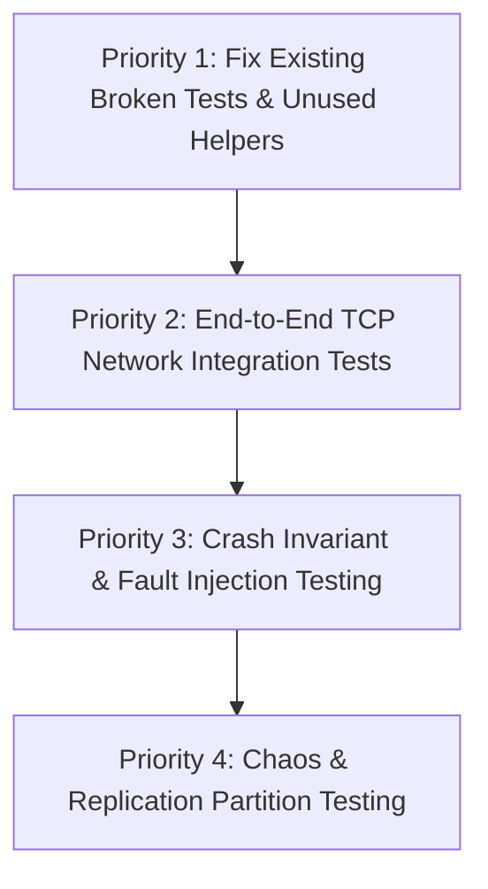

# 08 — Testing, Benchmarking & Debugging Audit

This document provides a comprehensive audit of the test suites, benchmark harnesses, performance bottlenecks, confirmed compilation issues, and diagnostic facilities in **FluxCache**, concluding with a prioritized testing plan for production hardening.

---

## 1. Test Suite Inventory & Coverage Analysis

The repository contains tests across three distinct locations:
1. **Unit Tests**: Inline within module source files (`src/*/tests`).
2. **Server Integration Tests**: `fluxcache/tests/integration_test.rs`.
3. **Client Integration Tests**: `fluxcache-client/tests/integration.rs`.

### 1.1 Test Breakdown Table

| Subsystem / Test File | Test Count | Scope & What Is Tested | What Is NOT Tested |
|---|---|---|---|
| **`cache::entry`** (`src/cache/entry.rs`) | 6 | Creation with/without TTL, expiration checks, `touch()` frequency increment, setting/clearing TTL. | Clock skew, integer overflow of frequency counter. |
| **`cache::lru`** (`src/cache/lru.rs`) | 8 | Eviction ordering, touch promotion to MRU, key removal, empty eviction, single element, repeated touch, free list reuse. | Large-scale churn, arena memory reclamation, hash collision handling. |
| **`cache::lfu`** (`src/cache/lfu.rs`) | 6 | Frequency-based eviction, touch increments, removal, empty evict, frequency decay halving, relative order preservation after decay. | Boundary frequency clamping at `u64::MAX`, non-deterministic eviction order within identical frequency buckets. |
| **`cache::ttl`** (`src/cache/ttl.rs`) | 6 | Expiration registration, collection of expired keys, removal, timestamp updates, batch size limit enforcement. | Behavior when thousands of keys expire within the exact same microsecond bucket; quadratic loop regression. |
| **`cache::store`** (`src/cache/store.rs`) | 12 | Basic SET/GET, GET nonexistent, DELETE, EXISTS, TTL expiration, EXPIRE command, LRU eviction under memory limit, overwrite key, FLUSH, background scan, 100-thread concurrent writers. | LFU eviction integration, shard memory imbalance, concurrent eviction under memory pressure, `ValueTooLarge` edge cases. |
| **`persistence::wal`** (`src/persistence/wal.rs`) | 7 | Record write and read, empty file, corrupted tail handling, CRC32 checksum mismatch detection, append resumption across sessions, large 100KB values. | File system full (`ENOSPC`), directory permissions failure, crash during partial header write. |
| **`persistence::snapshot`** (`src/persistence/snapshot.rs`) | 4 | Write and read roundtrip, empty snapshot, checksum corruption detection, atomic `.tmp` rename verification. | Disk full during `.tmp` write, read of partial 10-byte truncated header. |
| **`protocol::parser`** (`src/protocol/parser.rs`) | 14 | PING (upper/lower), GET, inline SET, SET with TTL, DEL, EXISTS, EXPIRE, TTL, STATS, unknown command, empty command, missing arguments, line frame extraction, multiple pipelined frames. | Malformed frame length prefixes, non-UTF8 binary data inside keys, maximum request size enforcement in streaming mode. |
| **`protocol::response`** (`src/protocol/response.rs`) | 7 | Encoding of OK, Data, Integer, Null, Error, negative integer, empty binary data. | Buffer capacity reallocation on multi-megabyte bulk data. |
| **`shard::consistent_hash`** (`src/shard/consistent_hash.rs`) | 8 | Empty ring, single node, deterministic mapping, distribution uniformity (10,000 keys across 3 nodes within 15% tolerance), minimal redistribution on node addition (moves $\sim 1/N$), duplicate node prevention, multi-node replication preference list. | Rapid node churn, ring empty wrap-around edge cases. |
| **`singleflight`** (`src/singleflight/mod.rs`) | 5 | Single request, error propagation to leader, concurrent deduplication (10 callers, 1 execution), independent parallel keys, failed request does not poison subsequent calls. | Cancellation / timeout of leader task, channel capacity overflow. |
| **`shutdown`** (`src/shutdown.rs`) | 2 | Single subscriber notification, multiple subscribers notification. | `is_shutdown()` state verification under concurrent task execution (see bug in Section 3). |
| **`fluxcache/tests/integration_test.rs`** | 8 | Direct store operations, TTL expiry, LRU eviction limits, concurrent writers (100 tasks), concurrent readers/writers (50 readers + 50 writers), singleflight coalescing (50 tasks), WAL+snapshot recovery, protocol roundtrip. | **Zero true network integration tests.** The helper function `start_test_server` is defined but never called! |
| **`fluxcache-client/tests/integration.rs`** | 1 | Client-to-server end-to-end SET, EXISTS, GET, DEL over TCP. | **FAILS TO COMPILE.** Cannot run due to missing fields in `Config` struct initializer. |

---

## 2. Confirmed Compilation Failure in Test Suite

When running `cargo test --workspace`, the compilation of `fluxcache-client/tests/integration.rs` fails with rustc error `E0063`:

```text
error[E0063]: missing fields `replica_of` and `replication_listen` in initializer of `Config`
  --> fluxcache-client/tests/integration.rs:19:22
   |
19 |         let config = fluxcache::config::Config {
   |                      ^^^^^^^^^^^^^^^^^^^^^^^^^ missing `replica_of` and `replication_listen`
```

### Root Cause
When replication capabilities were added to `fluxcache::config::Config` (`replication_listen: String`, `replica_of: Option<String>`), the integration test in `fluxcache-client` was not updated to supply these new struct fields.

---

## 3. Critical Gaps: What Is NOT Tested

1. **True TCP Client-Server Integration**:
   - In `fluxcache/tests/integration_test.rs:11-60`, the test author wrote `start_test_server()` and `send_command()`. However, **none of the 8 integration tests call these functions**. They test `CacheStore`, `WalWriter`, and `SingleflightGroup` directly in-memory, bypassing the TCP networking layer, frame extractor, and connection handler entirely.
2. **Network Protocol Edge Cases**:
   - Pipelined requests with partial packet fragmentation across TCP boundaries.
   - Slowloris attacks (sending 1 byte every 10 seconds to verify `read_timeout`).
   - Requests exceeding `max_request_size` (1MB).
3. **Replication End-to-End**:
   - Zero integration tests exist for `ReplicationServer` or `ReplicationClient`.
   - The primary-to-replica handshake (`PSYNC`) and live mutation streaming are completely untested by automated suites.
4. **Crash Recovery Under Dirty Power Loss**:
   - No tests simulate a crash occurring while `WalWriter` is halfway through writing a 30-byte header or payload.

---

## 4. Benchmark Methodology & Latency Profiling

### 4.1 Micro-benchmarking (`fluxcache/benches/cache_bench.rs`)
Implemented using the `criterion` framework:
- **LRU Touch (New Key)**: Measures insertion and free-list allocation overhead.
- **LRU Touch (Existing Key)**: Measures linked-list node detachment and MRU promotion (~15–20ns).
- **LRU Evict**: Measures tail eviction and hash map removal.
- **Consistent Hashing**: Measures binary search over sorted 150-vnode rings for 3, 10, and 50 nodes (~40–80ns).
- **Protocol Parsing**: Benchmarks `parse_command` on ASCII GET/SET and `Response::encode`.
- **Async Cache Store**: Measures `set()`, `get_hit()`, and `get_miss()` under a Tokio runtime.

### 4.2 Macro-benchmarking (`fluxcache-bench`)
A dedicated load-testing binary that spawns multi-worker Tokio tasks driving concurrent TCP connections:
- **Payload**: Configurable byte payload (default 256 bytes).
- **Workload**: Mixed read/write ratio (default 80% GET, 20% SET) over a 10,000 keyspace.
- **Latency Capture**: Uses `hdrhistogram::Histogram` to record microsecond latency across all requests and output `Min`, `p50`, `p95`, `p99`, and `Max`.

---

## 5. Architectural & Performance Bottlenecks

1. **Shard Write Contention on Reads**:
   - Every `GET` query takes a write lock on the target shard (`store.rs:130`). Under skewed key access (Zipfian distribution where 20% of keys receive 80% of traffic), high concurrency causes severe lock contention on popular shards, degrading throughput and increasing p99 latency.
2. **LFU Periodic Decay Latency Spikes**:
   - Every 10,000 accesses, `LfuPolicy::decay()` halts the shard, iterates through all tracked keys ($O(N)$), and rebuilds the entire frequency BTreeMap. This introduces periodic latency spikes that distort high percentiles (p99/p99.9).
3. **Quadratic Batch Cleanup in TTL Scanning**:
   - In `ttl.rs:92-97`, if an active expiration scan reaches `max_batch` mid-bucket, it executes a nested loop scanning all remaining BTreeMap value vectors, causing an unintended CPU bottleneck during mass expirations.
4. **Blocking OS Disk Syscalls in Async Worker Threads**:
   - `wal.sync()` executes `std::fs::File::sync_data()` directly on Tokio worker threads without `spawn_blocking`, stalling the thread during disk writes.

---

## 6. Prioritized Production Testing Plan

To prepare FluxCache for enterprise production readiness, the following test suites should be implemented:



### Priority 1: Fix Existing Test Suites
- Update `fluxcache-client/tests/integration.rs` to initialize `Config` with `replication_listen` and `replica_of: None` so that `cargo test --workspace` compiles cleanly.
- Activate `start_test_server` in `fluxcache/tests/integration_test.rs` to run tests over actual local TCP loops.

### Priority 2: End-to-End Network & Protocol Testing
- **Pipelining Test**: Send a single TCP packet containing 10 concatenated commands (`PING\r\nSET k v\r\nGET k\r\n...`) and verify all 10 responses arrive in exact FIFO order.
- **Payload Boundary Test**: Send frames of exactly `max_request_size` (1MB) and `max_request_size + 1` bytes; verify the latter receives `-ERR Request too large` without terminating the daemon.
- **Inactivity Timeout Test**: Open a TCP connection, send no bytes, and assert the server closes the connection after `read_timeout_secs`.

### Priority 3: Durability & Fault-Injection Testing
- **Mid-Write Truncation Test**: Truncate a WAL file at byte offsets 1, 4 (mid-magic), 15 (mid-header), and 35 (mid-payload); assert `WalReader::read_all` never panics and successfully recovers all preceding valid records.
- **Fuzz Testing**: Use `cargo-fuzz` or `proptest` to feed randomized byte sequences into `extract_frame` and `parse_command` to detect panics, infinite loops, or buffer out-of-bounds indexing.

### Priority 4: Distributed Chaos Testing
- **Replication Disconnect & Lag Test**: Throttle the replica socket read speed; assert the primary detects broadcast channel lag (`RecvError::Lagged`) and disconnects the replica gracefully.
- **Failover Verification**: Kill primary node; repoint replica to new primary; assert snapshot reload succeeds.
